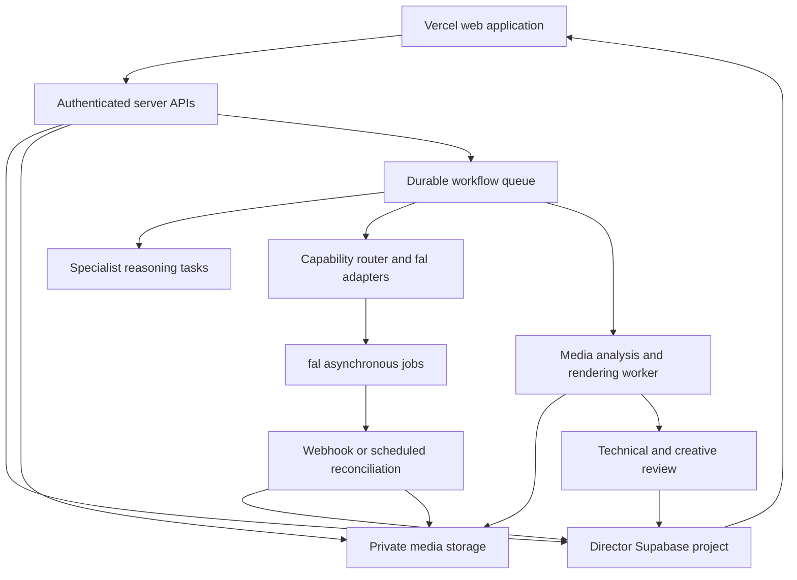

# Film Studio Blueprint Review Draft

Revision: 2, reviewed 2026-10-17 UTC. Status: proposed design for discussion. Application implementation, database migrations, paid model tests and deployment require a later decision. This draft supersedes the local prototype as a proposed design basis; it does not represent implemented capabilities.

## 1. Product decision

Build one knowledge-driven film studio with shared production records and specialist filmmaking capabilities. Short narrative films are the first end-to-end workflow, following the user's current priority. Music videos and talking-avatar work use the same foundation with distinct timing and performance requirements.

The production goal is a coherent, editable film with deliberate performances, consistent characters and world, intelligible sound, controlled revisions and a verified export. Access to a model catalog is an execution capability; filmmaking intelligence must plan, explain and evaluate the work.

The first proof should be a 45–60 second film. This is a validation scope, not a permanent product duration limit. Longer films require evidence that continuity, cost, job recovery and editing scale successfully.

## 2. Confirmed environment and remaining dependencies

| Component | Evidence and status | Design consequence |
| --- | --- | --- |
| GitHub | Prior reads/writes verified for gthawani-del/learningskills | Intended application repository; inspect its current head before implementation |
| Vercel | User reports deployment; supplied screenshot showed main commit 290c33d and a missing-page preview | Verify current source, framework, root directory and routes; do not assume the screenshot remains current |
| fal | User reports FAL_API_KEY stored in Vercel and supplied endpoint screenshots | Use fal as the primary model transport. Credential presence, endpoint permission and model execution remain unverified |
| Supabase | The connected account named director successfully returned project ygyjqubrpqwfgbquwqeo, status ACTIVE_HEALTHY, region ap-southeast-1 | Use this existing project as the proposed application backend; do not create another project |
| Database inventory | public-schema table listing returned none; migration listing returned none | No application schema was discovered in these inventories; other schemas were not audited |
| Supabase execution/storage | Edge Function listing and storage bucket metadata query returned none | Application functions and asset buckets still need design and implementation |
| Rendering | Local environment has FFmpeg; no hosted rendering worker verified | Choose hosted rendering after workload/cost validation; local availability is not a production deployment |
| Local prototype | Node/browser code exists locally from earlier work | Reference material only. Its in-memory jobs, browser-only state and synchronous rendering are unsuitable as the SaaS foundation |

The Supabase check used project discovery, metadata listings and one read-only bucket metadata query. No schema, data, keys, buckets or functions were changed. No credential values were retrieved.

## 3. Scope and evidence hierarchy

Historical environment observations in section 2 were checked on 2026-10-17 UTC in this session, except where explicitly marked user-reported or local. Evidence: the Director account project inventory; public table, migration and Edge Function listings; and the read-only storage.buckets metadata query. Vercel/fal observations are user reports/screenshots, not credential or deployment verification. Refresh relevant observations before implementation.

Current user decisions take precedence over conflicting historical proposals. Runtime behavior and evaluated outputs establish implementation facts. Official product documentation establishes documented behavior, not independent quality results. Skills provide workflow knowledge; their effectiveness must be tested. Document hypotheses remain hypotheses until evaluated.

The three uploaded reports supply the requirements baseline. Their earlier underlying documents, separate PRD/technical specification, and original four-platform HTML study were not independently supplied for this review. The master review's findings about those originals remain attributed findings.

Public reference-product investigation has not exposed proprietary backend orchestration. Do not describe this studio as a reproduction of a competitor's internal intelligence.

## 4. User journey

1. Create a film project: premise, audience, language, format, runtime and budget preference. Ask follow-up questions only for material ambiguities.
2. Develop the story: treatment, dramatic progression, characters, screenplay and dialogue. Users can bring an existing script.
3. Approve cast and world: reference identities, voices, wardrobe, locations, props and visual language.
4. Plan coverage: scene objectives, blocking, shots, camera/light intent, performance, sound and editorial relationships.
5. Review a timed storyboard or animatic. Confirm whether the story reads before expensive motion work.
6. Produce scenes using suitable fal endpoints. Show actual job state, spending and selected versions.
7. Review clips. Diagnose and replace the failed shot or segment while retaining accepted work.
8. Assemble and refine the timeline, dialogue, music, ambience and effects.
9. Review the cut, finish colour/captions/titles, verify the export and deliver a playable file.

Users should see Story, Cast & World, Storyboard, Production, Edit, and Review & Export. Each view shows the current artifact/version, approval status, next required decision and relevant spending state. Production activity is closed by default and opens on request. The detailed desktop/mobile interaction contract is in [Product Experience Specification](PRODUCT_EXPERIENCE_SPEC.md). Departments work behind these task-based views. Advanced controls expose shot specifications and model choice without requiring a public node editor.

Music-video entry: upload or create a song, establish authoritative audio and lyrics, then map visual narrative and performance to its actual timestamps. Do not force song timing into the narrative-film workflow.

## 5. Department responsibilities and contracts

A department is a responsibility with specialist knowledge, artifacts and review rules. It is not necessarily an independently deployed agent. Activate the responsibilities needed by the brief.

| Responsibility | Required inputs | Output artifacts | Acceptance focus |
| --- | --- | --- | --- |
| Development and writing | Brief, constraints, research, language | Treatment, beat structure, screenplay, character arcs, dialogue | Causality, dramatic change, filmable action, language and runtime plausibility |
| Producing and planning | Script, budget, capabilities | Breakdown, dependency graph, schedule, generation estimate and attempt allowances | Feasible coverage, complete dependencies, approved cost envelope |
| Directing | Treatment, script, character relationships | Scene objectives, blocking, emotional progression and performance notes | Every scene and shot has a purpose; action and performance communicate the intended change |
| Casting and performance | Character brief, approved rights, script | Identity/voice candidates, approved references, delivery and expression specifications | Identity, voice suitability, eyelines, readable performance and intended emotion |
| Production design | World, period, geography, characters | Location, set, prop, costume, makeup/look and palette references | Stable world logic and scene state; no accidental prop/wardrobe changes |
| Cinematography and lighting | Scene objective, blocking, world, delivery | Framing, perspective/lens intent, focus, support/movement, lighting and coverage plan | Motivated choices, usable coverage, screen direction and light consistency |
| Storyboarding and previs | Shot specifications, approved references, preliminary audio | Versioned boards, sequence timing and animatic | Story readability, timing and edit feasibility before full production |
| Animation and VFX | Approved shot, action, references, effect needs | Motion/effect plan, generated source clips, composites and repairs | Contact, physics, temporal stability and faithful action; route unsupported requests explicitly |
| Voice and dialogue production | Approved lines, voice, language, performance | Line takes, verified transcripts, timing and selected audio | Wording, pronunciation, emotion and usable timing; speech and singing evaluated separately |
| Music and sound design | Dramatic progression or master song, action timings | Music cues, ambience, Foley, effects and mix plan | Intentional sound choices, action sync, intelligibility and dynamic contrast |
| Editing, colour and finishing | Selected takes, source handles, sound, approved direction | Timeline, cut versions, colour matching, mix, captions, titles and masters | Pacing, continuity, synchronization, legibility, playback and delivery specification |
| Continuity and independent review | Approved bibles, adjacent shots, actual media | Timecoded findings, defect severity, acceptance and correction requests | Inspect outputs rather than trusting generation success or self-assigned scores |

For visual controls distinguish executable endpoint parameters, descriptive visual cues, and unsupported requirements. Camera names or focal-length text do not prove physical camera simulation.

Example: a character hiding a discovery should lead to specific blocking and eyeline choices, motivated close coverage, prop-state continuity, restrained sound and a reveal in the edit. The director and editor determine these relationships before the router chooses generation tools.

## 6. Skill and knowledge system

Maintain a versioned registry with: skill ID, scope, source and revision, license, prerequisites, inputs, output schema, decision rules, examples, counterexamples, tool requirements, limitations and evaluation cases.

Use dependency-aware specialist handoffs, audio-first performance where applicable, resumable execution and verified delivery. External agent frameworks are not integrations, coordinators, services or runtime dependencies of this application.

Use available storytelling, cinematography, character, music-video and review skills as specialist guidance. Respect fal as the chosen provider when adapting skills that default to another provider. Verify source licenses before copying material into the application.

Fill knowledge gaps deliberately: screenplay coverage, dialogue scenes, spatial continuity, production-design state, editorial continuity, location sound, mix decisions and long-form narrative consistency. Each gap needs cited primary/expert material and test cases rather than an invented specialist persona.

Retrieve only relevant skill sections and approved project context for each reasoning task. Conventional software handles permissions, asset transport, validation, arithmetic, scheduling, billing records and encoding. Do not spend LLM calls on deterministic work.

Knowledge updates, project memory updates, benchmark updates and model retraining are separate processes. Promote a new skill/model version only after regression evaluation; retain rollback versions. User-facing explanations contain decisions, evidence and tradeoffs, not hidden chain-of-thought.

## 7. Shared production record

Proposed logical records, to be refined into an implementation schema after review:

| Record group | Essential content |
| --- | --- |
| Workspaces, memberships, projects | Tenant, member role, project access, film type, brief and delivery targets |
| Brief/treatment/script versions | Approved constraints, scenes, action, dialogue, character references and source research |
| Characters, voices, looks and world elements | Versioned identities, wardrobe, locations, props, reference assets and use permissions |
| Scenes and shot versions | Dramatic purpose, duration, blocking, camera/light/performance intent, sound, start/end state and references |
| Skills and workflow runs | Versions used, dependency graph, inputs, structured outputs, task ownership and run history |
| Model registry and evaluations | Exact endpoint/version, capabilities, adapters, pricing observations, benchmark provenance and limitations |
| Provider jobs and attempts | Request identity, idempotency key, exact submitted inputs, status history, provider ID and retrieval outcome |
| Assets and lineage | Durable object pointer, hash, metadata, provenance, source job, versions and dependencies |
| Approvals, reviews and comments | Artifact/version scope, reviewer, timestamp, findings, selected take and supersession |
| Timeline versions and exports | Rational timebase, clip in/out and handles, audio tracks, transformations, render manifest and validation |
| Budget and cost ledger | Estimates, reservations, known charges, uncertain charges, retries and remaining authorization |

Every tenant-owned record includes a workspace relationship. Enforce membership/project authorization through row-level policies; authentication alone does not authorize access to another workspace. Storage paths and signed access follow the same ownership model. Provider credentials and privileged Supabase credentials remain server-side.

### Enforceable shot contract

Every approved shot version distinguishes mandatory requirements, permitted variation, evidence for acceptance, and explicit failure conditions. Mandatory items are hard constraints for acceptance, not claims of guaranteed generation control. Unsupported requirements must be disclosed before authorization; a beautiful alternative does not silently satisfy the approved contract. Missing review evidence remains unverified. The worked example in Product Experience Specification follows the full contract through a hypothetical output and correction.

### Intended and observed continuity

Maintain separate intended and observed scene-state snapshots: positions, prop ownership and hand, wardrobe condition, physical state, emotion, and each character's knowledge. Selected footage supplies observations. A discrepancy is a defect until an authorized creative change explicitly revises intended state; generated mistakes must not become upstream truth for subsequent shots. State changes are versioned and invalidate dependent work as appropriate.

## 8. Approval and revision rules

Approvals attach to exact artifact versions and a scope. Identity approval does not approve every wardrobe, angle or expression. Approving a frame does not approve the generated motion or final sound.

Track dependencies explicitly. A change creates a new version and marks affected descendants for review; it does not delete approved assets or silently regenerate them.

- Dialogue change: flag voice take, lip-sync, captions, timing and dependent edits.
- Character/look change: flag dependent boards, clips and continuity reviews.
- Shot trim: flag synchronization, transition handles and adjacent editorial relationships.
- Soundtrack change: flag mix and cue alignment; for music videos it can affect the full timing plan.
- Typography correction: fix the composited title layer when possible, retaining accepted footage.

Suggested review checkpoints: treatment/script; cast/world; storyboard/animatic and production estimate; difficult-shot pilot; rough cut with sound; final master. Consolidate checkpoints for small projects while preserving budget authorization and required artifact review.

### Performance dependencies

For audio-driven visible dialogue: approved wording → selected voice take and delivery → measured timing/pauses → visible performance/lip-sync → synchronization review. Silent/action shots do not need this dependency. Joint audio/video generation follows a distinct route: verify actual words, delivery and timing against the contract before accepting the take. A music video's authoritative song timing must not change to accommodate footage without explicit approval.

## 9. fal model router

Use fal as the primary transport for text, images, video, speech, music and lip-sync where verified endpoints satisfy the task. Pass FAL_API_KEY explicitly through the server adapter or map it to the SDK's expected credential configuration; never rename or expose secrets casually.

Choose a tested, versioned sequence production profile first: approved reference set, visual treatment, performance path, timing policy and compatible route families. Assess each candidate beside its neighboring selected shots and include matching/repair effort in route economics. This permits multiple models without optimizing every shot in isolation. Details: [Tool Registry Specification](TOOL_REGISTRY_SPEC.md).

Routing sequence:

1. Derive task requirements from the approved shot, not just the user's raw prompt.
2. Filter by supported references, editing modes, duration, resolution, aspect ratio, audio/lip-sync capability, availability, usage terms and approved budget.
3. Rank eligible endpoints using our task-specific benchmarks, including accepted-result cost and retry burden.
4. Validate the payload against the exact endpoint schema. Preserve model-specific adapters behind a normalized internal task interface.
5. Show the selected route, relevant tradeoff and estimate; record the accepted route/version before submission.

Draft/Balanced/Quality presets can change speed and expense preferences, but cannot relax mandatory identity, dialogue or delivery requirements. A model switch may require new approval when its capabilities or appearance differ.

Initial candidate families from the user's screenshots include MiniMax, Kling, FLUX, Seedream and ElevenLabs. Truncated screenshot names are not canonical endpoint IDs. Verify exact IDs, schemas, pricing, permission and current availability before selection. Keep text planning, speech, singing, avatar animation and lip-sync separate task classes.

No permanent default model is approved yet. Do not claim a model is best without results. No automatic paid fallback after an uncertain submission: reconcile the original request first.

## 10. Proposed application architecture

Proposed web stack: Next.js, React and TypeScript on the existing Vercel project. Validate repository root/build settings before migration. Keep the local prototype for reference, not as a production server to deploy unchanged.

Use the verified Director Supabase project for authentication, access control and relational production metadata. Storage recommendation for initial validation: evaluate private Supabase Storage first to reduce integration count. The uploaded reports propose R2; retain it as a candidate when egress, media volume or existing provisioning justifies it. One logical asset registry should support either, avoiding duplicate media libraries.

Use a durable queue and worker leases with bounded concurrency. A browser tab, an in-memory Map and a long Vercel request are not job persistence. Choose the queue mechanism after checking supported features and workload requirements.

Use a separate worker for substantial FFmpeg/media analysis and rendering, or a verified hosted rendering service. Railway is a candidate from the documents, not a connected dependency. Do not assume fal provides the required timeline compositor without inspecting its exact capability.

Transfer media through signed uploads and durable object references. Avoid base64 video uploads through Vercel functions as the normal transport. Copy accepted provider output to project-controlled storage where allowed; expiring provider URLs are not the archive.

## 11. Durable jobs and spending

Keep provider execution, asset retrieval, creative approval and delivery states separate.

Task execution: planned → ready → submitting → queued/running → provider-succeeded → retrieving → stored. Failure, cancellation request and unknown submission are explicit branches. Provider cancellation support is endpoint-specific; cancellation does not promise a refund.

Review: unreviewed → pass / needs-human-review / fail. Unperformed checks remain unverified. An export has its own rendered, decode-checked, playback-reviewed and delivered states.

Before any paid operation, perform one server-controlled atomic budget check and reservation across concurrent jobs. Include finishing/export allowance in the project budget; generation cannot consume that reserve. An unknown submission retains its reservation until reconciled, without automatically releasing it on timeout. Record reservation, settlement and adjustments with idempotent ledger events.

Internal request deduplication is not evidence of provider billing idempotency. Each adapter must explicitly record whether the provider guarantees it, supports reconciliation only, or leaves that capability unknown.

Persist submission intent and idempotency identity before a paid call. Store the provider request ID immediately when received. Reconcile timeouts and duplicate webhooks without resubmitting or double-counting charges. Reuse accepted artifacts after worker restarts.

Budget policy proposal: one initial attempt plus one diagnosed correction per shot, within an approved monetary ceiling. Further attempts need a new decision. Distinguish creative attempts from retrieval or infrastructure recovery; every potentially billable operation still counts toward spending. Track all billable operations, including audio and sync operations, rather than hiding them under one creative shot. Prices and unavailable charge data are labeled estimates or unknown; do not invent actual charges.

## 12. Quality and evaluation

Use deterministic checks for codecs, dimensions, frame rate, duration, corruption, timing and audio measurements. Use assisted review plus human judgment for dramatic intent, performance, continuity, motion and visual defects. Do not equate face similarity with identity certainty or a contact sheet with successful temporal/lip-sync review.

Critical failures override aggregate scores. No universal score such as 0.9 proves artistic quality. Calibrate any automatic detector against labeled examples before allowing it to accept or reject work autonomously.

Evaluation suite:

- Character across different framing, wardrobe and location, with explicit comparisons to approved references.
- Dialogue performance with readable mouth, eyelines, reaction coverage and audio timing.
- Camera movement and physical interaction with continuity across adjacent shots.
- Ambient/action sound, dialogue intelligibility and intentional musical pacing.
- Short music excerpt with measured timing and a distinct singing test before enabling singing claims.
- Fault injection: lost network response, webhook duplication, worker restart, expired output URL, rejected render, cost ceiling and selected-shot revision.
- Tenant isolation: a member cannot access another workspace's records or media.

Measure accepted-shot rate, revisions, cost per accepted second/minute, human intervention, turnaround and narrative/performance review. Comparisons need matched tasks, references and budget conditions. We have not established superiority over competitors.

### Public service requirements

Before paid public use, enforce scoped consent/use-rights records, private asset access, retention/deletion rules and tenant isolation. Treat scripts, uploads, retrieved documents and model output as untrusted content: none may authorize spending, grant tool access or override an approval. These engineering requirements are separate from a promise of legal certification.

## 13. Proof film and delivery gate

Proposed pilot: 45–60 seconds, one coherent dramatic turn, one or two recurring characters, a motivated location change, varied coverage, a spoken exchange, ambience/effects and score. Agree on a bounded generation budget before running it.

Approve the pilot acceptance sheet before paid tests: an unfamiliar reviewer can identify the intended dramatic change; mandatory actions/framing/dialogue adhere to the contract; no unresolved critical continuity/performance/sync defects remain; one targeted revision preserves unaffected accepted assets; interruption recovery does not create an unapproved repeat submission; uncertain costs remain unresolved rather than invented. Record technical export success, creative pilot acceptance and economic validation independently. Passing one does not pass the others.

Required evidence: approved treatment, versioned references, timed storyboard/animatic, actual job/asset manifest, edited film with sound, per-shot findings, all production costs available, one deliberate targeted revision and a final playable MP4. Report unavailable cost/quality evidence explicitly.

A short trial is a scale limit for validation, not a reduction in departmental responsibility. Expand runtime only after the pilot's dependencies and economics hold up. Music-video proof then reuses the same production core with song timing and singing-specific acceptance.

## 14. Implementation sequence after review

| Stage | Deliverable | Exit criterion |
| --- | --- | --- |
| A | Reconcile deployed source, application structure and infrastructure | Known repository/head/root, working preview route, agreed storage/worker choices |
| A1 | Small budget-authorized test of hardest shot plus an actual hosted render test | Capability, output retrieval, rendering path and limits are established before extensive workflow development |
| B | Identity, project records, asset lineage and permissions | Persistent tenant-isolated projects and authorized media access |
| C | Skill contracts and brief-to-storyboard pipeline | Structured, editable outputs with saved versions, dependencies and approvals |
| D | Bounded fal benchmark and first adapters | Verified endpoint schemas, actual samples and task-specific route evidence |
| E | Durable production jobs, reviews and costs | Resume/reconcile without duplicate submission; retain accepted work |
| F | Timeline, sound and worker-based render | Repeatable export with technical and playback review |
| G | Complete pilot and targeted revision | Coherent reviewed film, documented defects, cost and revision behavior |
| H | Music-video workflow, longer films and collaboration | Separate timing/performance evaluations and demonstrated scaling |

Keep benchmark work early enough to influence design. Do not build a large model catalog before discovering which capabilities reliably deliver the required shots.

## 15. Resolved conflicts and deferred research

| Historical conflict | Proposed resolution |
| --- | --- |
| Music-video-first versus short-film-first | Short film first under current instruction; preserve the music-video branch |
| 21 agents versus fewer specialist modules | One responsibility map with selective tasks; no fixed agent count |
| Character training before casting | Approve identity and reference views first; test training only if needed |
| All scoring layers active by default | Production checks required; speculative neural/persuasion/recall scores deferred |
| Three versus five concept cards | Taxonomy and presentation count are separate; normally show a small set only when the user needs alternatives |
| Pre-checks versus final review | Apply relevant checks to both planned and actual artifacts |
| Universal deliverables | Agree on film-specific duration, ratio, codec, sound and optional captions/stems |
| Regenerate until passing | Finite diagnosed attempts with cost authorization and an honest failure state |
| Immediate self-learning | Saved project memory now; evaluated skill/model releases later |

Research backlog: audience-response prediction, memorability gains, style-vector training, guaranteed identity locking, universal automatic repairs, full legal certification, extensive trend ingestion and broad product-catalog automation. These are not launch dependencies.

## 16. Review decisions

The proposed direction is short-film-first with all relevant departments represented, reference-led continuity, fal-based generation, persistent Supabase production records, bounded attempts and an independently reviewed pilot.

Decisions to discuss before application changes: accept this overall contract; select initial storage/rendering arrangement; define the pilot's creative brief and budget. Endpoint defaults follow schema inspection and evaluated samples. No paid experiment budget is implied by approval of this document.

## 17. Source map

- Director_AI_Deduplicated_Master_Review.docx: sections 2–10 and 15–17 supply capability consolidation, production dependencies, conflict and claims registers.
- Creative_Studio_Music_Video_SaaS_Window_Report.pdf: pages 1–5 and 7 supply shared-foundation, workflow, economics and acceptance proposals. UI pages 6–7 are static concepts.
- Music_Studio_Full_Discussion_Report.pdf: sections 1–12 supply hybrid audio interpretation, reference-based identity, adapters, quality evaluation and infrastructure proposals.
- [Higgsfield build account](https://higgsfield.ai/blog/how-we-built-cinema-studio): documented separation of filmmaking knowledge and interchangeable generation models.
- [OpenArt storyboard workflow](https://openart.ai/features/ai-storyboard-generator/): documented script-to-board and reference workflow.
- [Hedra Studio](https://www.hedra.com/studio): documented reusable Skills/Elements and shared creative workspace.
- [LemonSlice](https://lemonslice.com/): documented live-avatar workflow; live conversational avatars are distinct from film performance rendering.

Reference-product claims are attributed documentation, not independently benchmarked quality. This blueprint is an original proposed system, not a claim of access to private competitor implementations.

Related planning: [Product Experience](PRODUCT_EXPERIENCE_SPEC.md), [Tool Registry](TOOL_REGISTRY_SPEC.md), [Reference Evidence](REFERENCE_UX_RESEARCH.md).

Related execution coverage: [Functionality to Endpoint Matrix](FUNCTIONALITY_ENDPOINT_MATRIX.md), [CSV contracts](FUNCTIONALITY_ENDPOINT_MATRIX.csv), [candidate registry](TOOL_REGISTRY_CANDIDATES.json). These supersede any inference that the four initial endpoint examples covered the whole product.

Current model/tool bindings, all 105 function contracts and dated costs are consolidated in [Model Router Intelligence Bible](MODEL_ROUTER_INTELLIGENCE_BIBLE.md). Earlier endpoint examples are historical where they differ.
