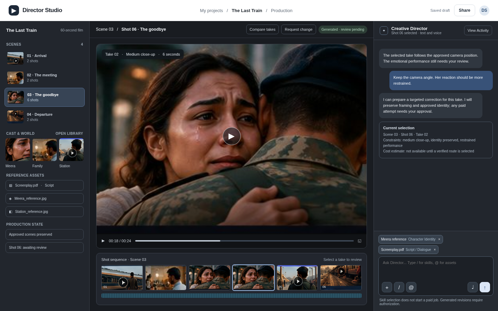
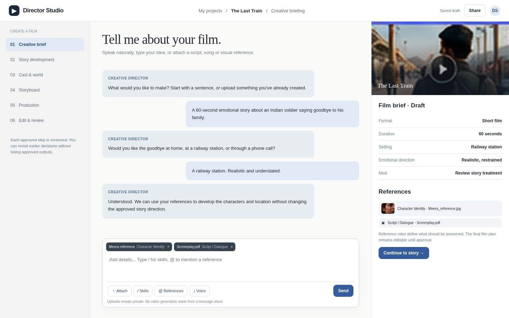
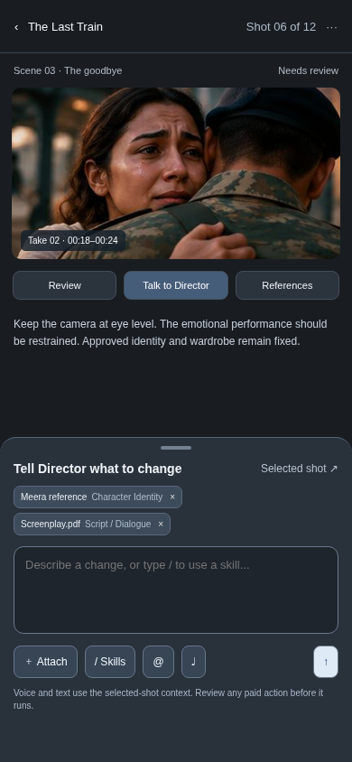
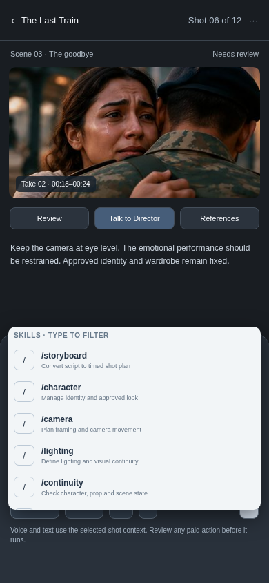
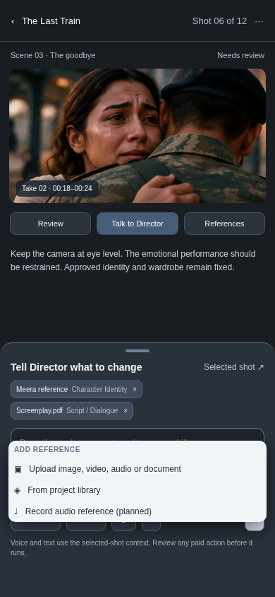

# Director Studio | Customer-Facing UI/UX Specification v2.0

**Status:** Design proposal and implementation handoff; not an authorization to deploy or spend.  
**Surfaces:** Desktop web, responsive tablet, mobile web.  
**Primary launch track:** Short films; shared foundation anticipates music videos and advertising.  
**Companion:** `FILM_STUDIO_BLUEPRINT.md`. This is the **customer-facing** product, not the administrator backoffice.  
**Artifacts:** Working demonstration HTML and five rendered reference images accompany this specification. All sample films, uploads, chats and UI actions are illustrative.  
**Design decision:** Reusable multimodal composer; desktop project/canvas/Director workspace; voice or text; skill discovery through `/`; project references through `@`; uploaded assets through `+`; explicit approvals and spending authorization.

---

## 1. Executive decision and design boundaries

Director Studio is a film-creation environment, **not a prompt box wrapped around model APIs**. A newcomer should be able to explain an idea, attach examples, reach a reviewable treatment and storyboard, and understand the next consequential decision. Experienced users should be able to bring scripts, images, audio and existing footage without repeating the first-time interview.

The authoritative flow remains: **Brief -> Story -> Cast & World -> Storyboard / Animatic -> Production -> Edit & Review -> Export.** Each stage has versioned artifacts, acceptance criteria and the possibility of returning to an earlier stage without silently invalidating accepted work. Other production formats have distinct intake/timing logic but reuse the project, asset, approval and job framework.

**Non-negotiable rules:**

- Ordinary creative information and the next decision are visible. Background orchestration and technical activity are **collapsed by default**; `View Activity` exposes an understandable event summary only when clicked. Never reveal raw hidden model reasoning or privileged implementation logs.
- The brand or name of any external orchestration framework must never appear in the product interface, user help, product documentation, or management panels. Implement desired patterns natively.
- Adding references, selecting `/skills`, mentioning `@assets`, editing a brief or recording speech **never launches paid generation implicitly**.
- Show known/estimated additional charges before a paid operation, and require authorization under the current project budget. Unknown price blocks submission until it can be estimated/authorized.
- Protect approved constraints, shots and neighboring assets. A correction targets affected versions rather than rerendering an entire film.
- Do not represent model features as guaranteed: character-lock, camera precision, audio synchronization and automatic defect repair all require endpoint- and output-specific verification.
- The demo is not connected to real voice services, private storage, a production database, payment authorization, or live model generation.

### 1.1 Scope of this document

This document expands the previously discussed UI Factory direction into layout rules, page flows, micro-interactions, screen states, accessibility requirements, data contracts and developer acceptance tests. It does not replace the film-production architecture. Separate technical decisions about the job queue, storage, provider schema and rendering remain governed by the companion blueprint.

### 1.2 Priority classes

| Priority | Meaning | Representative features |
|---|---|---|
| P0 | Necessary to validate the customer film workflow | Uploads with roles, composer, `/` picker, `@` references, typed messages, shot context, auth, project persistence, shot approvals, budget gates, responsive review |
| P1 | Important for differentiated creation and early retention | Tap-to-talk transcription, spoken replies, targeted shot repair, comparison, richer reference inspection, full keyboard/clipboard media handling |
| P2 | Only after core usability/economics are proven | Opt-in continuous realtime Director, live multiuser co-creation, advanced node canvas, granular mobile multitrack editing, expressive talking avatar |

---

## 2. UX principles and research interpretation

Current public product patterns from Runway, Krea and Hedra show that people expect conversation, references, assets, generated media and editing to stay near each other. Published product materials describe slash/mention interactions in some modes, reusable references and accessible creation panels; **do not assume their implementations, entitlements or exact three-way geometry are identical**. Our response is task-driven: three adjustable panels on desktop, two on medium screens, one focused canvas on phones.

**UI Factory framework:** task-first interaction hierarchy with Material 3 conventions for controls, modal/sheet behavior, keyboard focus, responsive reflow and status indicators. An editorial light surface suits first-use briefing. Graphite media surfaces suit detailed editing; restrained blue indicates selected actions. No fluorescent neon, fake futurism, oversized decorative hero, ornate typography or content-free cards.

**Design-test hypotheses, not proven conversion results:** the first film treatment should arrive without compulsory model selection; optional voice lowers input friction; scoped references reduce unexpected character drift; preview-before-render reduces avoidable spending. Validate these hypotheses with real users and production-cost data.

---

## 3. Users, journeys and FTUE

### 3.1 Two primary profiles

**First-time creator:** knows the outcome, not filmmaking vocabulary. Enters through homepage, chooses Short Film, speaks or types a premise, optionally attaches references, answers only consequential questions, reviews a treatment and a timed visual plan, then decides whether to spend on production.

**Returning/professional creator:** opens Recent Projects or `Create from assets`, uploads an existing script/shot list/song/reference pack, inspects extracted content, corrects misclassified asset roles, optionally opens advanced shot specifications, and returns to the current edit or approval with state preserved.

### 3.2 Customer FTUE flow

| Step | Primary question | User sees | Primary action | Recovery |
|---|---|---|---|---|
| 1. Welcome | What should I make? | Short Film, Music Video, Advertisement; voice/text entry | Describe film | Change format without losing text |
| 2. Brief | What story do I mean? | Director conversation and editable extracted constraints | Continue to treatment | Correct transcription/reference roles |
| 3. Story | Does the story work? | Treatment, scenes, dialogue and story change | Approve story | Request rewrite without video spend |
| 4. Cast & World | Who/where must remain stable? | Approved reference candidates and intended use | Approve identity/world | Replace or exclude source image |
| 5. Storyboard | Will the film read? | Shot images, specifications and animatic timing | Approve and get estimate | Revise individual shot/sequence |
| 6. Production | Are outputs acceptable? | Generated takes and review findings | Accept or request targeted revision | Reconcile failures; preserve accepted assets |
| 7. Edit & Export | Is the whole film ready? | Rough/final cut and delivery options | Approve and export | Fix sound/captions or retry export only |

**Account gate:** let visitors begin the brief, but require sign-in before persisting private assets, inviting collaborators or authorizing paid work. If sign-in interrupts a drafted prompt, preserve it after successful authentication where technically supported. Do not assume anonymous uploads are permanently stored.

**FTUE success metric (proposed):** a newly signed-in user reaches a **reviewable, editable story treatment and storyboard** with understood constraints. A first playable export is a later, separately reported activation milestone. Do not invent a time-to-first-film commitment.

---

## 4. Information architecture and navigation

### 4.1 Top-level customer destinations

- **Home:** new project, resume, recent projects. This is not the Admin Today dashboard.
- **Projects:** searchable project cards with status, last edited, accepted assets and next required action.
- **Library:** user/workspace-permitted reusable characters, locations, scripts, music and uploaded media, with licenses and reference roles.
- **Workspace:** selected project and stage. Primary tabs: Story, Cast & World, Storyboard, Production, Edit, Review & Export.
- **Account / Usage:** plan/entitlement, project spend, security, microphone preferences and storage policy.

### 4.2 Screen inventory

| Screen | Desktop treatment | Mobile treatment | P |
|---|---|---|---|
| Public homepage | Light editorial entry + Short Film featured | Narrow text/voice entry + format selector | P0 |
| Signed-in home | Recent projects, create action, continue work | Project cards, prominent voice entry | P0 |
| Voice/text briefing | Conversation plus evolving brief/reference panel | Conversation and dedicated composer sheet | P0/P1 voice |
| Story editor | Structured treatment and scene list | Readable story cards and change request | P0 |
| Cast & World | Reference gallery and role/consent inspector | Swipeable character/world cards | P0 |
| Storyboard | Shot grid, detail inspector and animatic | Shot-by-shot review with clear approval | P0 |
| Production studio | Three-pane project/canvas/Director | Canvas + Director bottom sheet + reference drawer | P0 |
| Editing | Centre timeline, media viewer and sound controls | Simple trim/annotate/select; desktop for complex edits | P1 |
| Final review/export | Playable cut, comments, output parameters | Playback, review and export action | P0 |
| Media library | Search, filter, reference role, lineage | Filter and select existing asset | P0 |
| Usage/settings | Itemized estimates/actuals, account | Focused usage and settings pages | P0 |

---

## 5. Visual design system

### 5.1 Surfaces and typographic rules

| Token | Suggested value | Use |
|---|---|---|
| `--canvas-light` | `#FAFAF8` | Briefing/home base |
| `--light-panel` | `#FFFFFF` | Cards and attachment previews |
| `--light-border` | `#E0E4E8` | Subtle boundaries |
| `--studio-bg` | `#191C21` | Media canvas surround |
| `--studio-panel` | `#22262D` | Project and Director panels |
| `--studio-border` | `#3C424C` | Studio separators |
| `--primary` | `#355D9D` | Selection, authorizing navigation |
| `--text-dark` | `#242B33` | Light body text |
| `--text-light` | `#EDF0F3` | Dark body text |
| `--positive` | `#9BC1AB` | Reviewed/succeeded state, with text label |

Typography: a standard reliable sans for functional UI (proposed **IBM Plex Sans** where permitted, with system sans fallback), plus an unobtrusive serif heading only in the editorial briefing; avoid decorative handwriting or trendy AI landing-page conventions. Ensure desktop primary body text normally 13–15 CSS px, mobile main text at least 14px and readable labels, subject to verified responsive/accessibility review. Do not use a colored badge as the only indicator of approval.

### 5.2 Spacing and constraints

- Base spacing unit: 4 CSS px; controls typically 36–44px high on desktop and touch controls typically at least 44px on mobile.
- Corner radii: 8px inputs/controls, 10–12px panels, 16px modal and bottom sheet.
- Borders and modest elevation separate functionally distinct zones; no gratuitous shadows.
- Use aspect-ratio-preserving media with letterboxing rather than cropping approved shots to fill a viewport.
- Icons always have accessible names. Do not use hover to reveal an essential function on touch devices.

---

## 6. Desktop Production Studio: three-pane layout



**Entry:** existing project in Production, with selected scene/shot and at least one take.  
**Success:** inspect the take, add references or a skill, ask for a constrained correction, review cost and accept/deny without altering unrelated accepted footage.

### 6.1 Grid geometry

At a 1440px viewport use approximately **18% left / 57% canvas / 25% right** (excluding global header); target 20/55/25 is an acceptable starting alternative. The centre must have a practical minimum of approximately 560px for detailed editing, otherwise collapse optional side content. Proposed min/max constraints: left 220–340px, right 300–480px, centre flexible. Persist individual user panel preferences per device class if authorized; do not force a phone to inherit desktop widths.

**Resize behavior:** dragging a splitter should update local widths, preserve focus/selection and avoid resizing below useful media controls. Double-click or `Reset layout` restores defaults. Keyboard resize commands/accessible handles are required if draggable controls ship; otherwise use collapse/expand controls first.

### 6.2 Left pane: project intelligence, not a generic file explorer

Contents in descending priority: project identity and status, numbered scenes, selected shot/sequence, Cast & World thumbnail grid, Project References, optionally asset library and current production-state summary. Clicking a character or location opens its reference inspector; it must not silently attach an unrelated asset to the next generation.

**Reference inspector:** asset preview, filename/type, declared role, project/scene/shot scope, version, approved/rejected state, source/licensing/consent status, and `Use in this shot` action when allowed. Deleting a reference is distinct from removing its use in a single message.

Use collapse groups for long productions. Search/filter scene lists with stable scene IDs, not brittle display positions.

### 6.3 Centre pane: media-first and stable

Toolbar shows project > scene > shot breadcrumbs, selected take, available compare mode and review status. Main area uses a video/image player with meaningful play/seek, comparison and frame annotation affordances. Below it show the selected scene's timeline/shot strip, with dialogue/score/ambience rows only when present. An approved take may still require sound or edit approval; represent these independently.

When there is no generated take: show the approved storyboard frame, requirements and **estimated** next-generation cost if verified. Never show a fabricated completed video frame or progress percentage.

Actions: `Compare takes`, `Request change`, `Approve take`, `View shot specification`, `Review adjacent shot` and contextual export actions. Each action is active only when its prerequisites are satisfied.

### 6.4 Right pane: AI Director and composer

Top: Director label, currently scoped item, optional `View Activity`. Middle: concise conversation and current-shot decision cards. Bottom: sticky multimodal composer. Do **not** permanently expose agent-to-agent logs. The right pane can collapse for media review; a compact `Talk to Director` launcher reopens it with the exact selected shot.

Selection context must be explicit, e.g. `Scene 03 / Shot 06 / Take 02`, with a clear option to change scope to scene/project before submitting. The Director must not infer arbitrary scope from vague chat history.

### 6.5 Primary desktop empty/failure cases

- **No project:** show `Create a film` and `Open project`, not empty production metrics.
- **No selected shot:** select from the scene list or offer guided storyboard creation.
- **No generated take:** show approved board, required reference checklist, and `Prepare generation` only after price check.
- **Failed/unknown provider submission:** display recorded job status and non-billable `Check status`; do not offer blind repeat generation.
- **Reference missing/expired:** explain how to restore it and which downstream work is affected.
- **Budget exhausted:** suggest revised estimate/new authorization, never auto-charge.

---

## 7. Desktop Voice/Text Briefing



The briefing layout deliberately departs from the production layout. A persistent stage list (left), conversational briefing (centre) and evolving film brief/reference inspector (right) are more useful here than a large empty video player.

**First-time state:** one welcoming question, example creative formats, voice/text entry and attach affordance. Avoid more than one or two clarifying questions at a time. Critical details: format, premise, intended runtime, language, characters/location if relevant, and desired emotion/style. Do not insist on advanced model names, frame rates or lenses before the idea exists.

**Returning state:** open the existing script/treatment, show what was extracted, ask permission before replacing user-authored lines, and explain any incompatible new reference. Reference chips remain attached to the draft and also appear in the right-hand `Film brief` summary.

**Controls:** `+ Attach`, `/ Skills`, `@ References`, microphone, Send, Continue to Story. The main Send action drafts/proposes a plan; it does not launch a paid motion job.

**Voice design:** tap-to-talk is recommended for first release, using visible states `Idle`, `Requesting microphone permission`, `Listening`, `Transcribing`, `Transcript ready`, `Sending`, `Speaking response`, `Error`. Display editable transcript before send for consequential instructions. Spoken replies are optional and off by default in public/shared settings. Long continuous real-time sessions are opt-in, cost-managed and deferred until proven valuable.

**Story treatment gate:** the user can correct the draft, review generated scenes, and accept a **specific artifact version**. An unaccepted plan is not permitted to trigger paid generation.

---

## 8. Mobile: focused canvas and Director bottom sheet



**Recommended mobile default:** full-width selected-shot preview, short review summary and a persistent `Talk to Director` action that opens a context-aware bottom sheet. Three permanent desktop columns are forbidden on small screens. Desktop-style advanced editing remains optional, not crammed into 390px.

Mobile functions: choose previous/next shot, approve/reject selected take, open references, attach from device/photo library, use Skills button or type `/`, mention references with `@`, tap microphone, review transcript, inspect budget impact and authorize a targeted correction. The bottom sheet must avoid covering the keyboard, safe-area indicator and its own controls; expand and scroll within available viewport height.

**Mobile skill menu state:**



**Mobile attachment menu state:**



Tablet recommendation: two working columns at sufficient width (canvas and Director) with project assets as a drawer. At approximately 1000px and below, prioritize media width over retaining all three panes. Exact breakpoints should be tested based on actual content, not device names alone.

---

## 9. Universal multimodal composer: component specification

### 9.1 Component scope

One `DirectorComposer` should be reused by Homepage/FTUE, Briefing, Storyboard, Production and Edit. Props provide `workspaceId`, `projectId`, optional `sceneId`, `shotId`, `takeId`, `stage`, `mode`, `allowedSkills`, `acceptedAssetRoles`, `permissions`, `budgetPolicy`, and a `draftId`. It should not contain business logic for charging providers.

**Visible anatomy:**

1. Input placeholder that adapts to context: `Describe your film` on FTUE versus `Ask Director about Shot 06` in Production.
2. Token row for referenced project assets, attachments and selected skills. Tokens show filename/short label and declared role.
3. Toolbar: `+` attachment, `/` skill, `@` existing references, microphone, send. Label controls on mobile or provide accessible names and discoverability.
4. Context indicator showing project/scene/shot; click to inspect or change scope.
5. Draft save state and any upload/transcription/validation error, visible near the control affected.
6. Price/permission warning only when a planned action is consequential; do not decorate every idle composer with billing notices.

### 9.2 Input types and file pathways

| Input | Provisional supported formats | Example role |
|---|---|---|
| Still image | JPEG, PNG, WEBP | Character Identity, Wardrobe, Location, Visual Style, Prop, Shot Reference |
| Video | MP4, MOV, WEBM (verify backend decode) | Action Reference, Camera Motion, Existing Footage |
| Audio | WAV, MP3, M4A (verify metadata and vendor route) | Master Song, Dialogue Reference, Voice Reference, Ambience |
| Document | PDF, DOCX, TXT, MD | Screenplay, Treatment, Shot List, Brief |
| Project library | Authorized records only | Existing character, voice, location, shot, timeline asset |

**Policy:** configure size/length, file count, MIME allowlist and quotas server-side after provider/storage validation. Do not invent universal limits or advertise an unsupported format. Validate MIME using server inspection rather than filename alone. Uploaded documents/images are untrusted input; content must never override system permissions or approve spending.

### 9.3 Upload sequence and scope

1. User selects/drop-pastes files or chooses Library. Client displays queued file chips immediately.
2. Server validates session, workspace access, provisional MIME/size and quota; returns signed **scoped** upload target if permitted.
3. Client uploads directly to private object storage with progress and cancel (when supported).
4. Server finalizes asset: checksum, MIME verification, metadata, provenance, malware/unsafe-file handling where relevant, license/consent record and durable asset ID.
5. User chooses reference role and scope (project, scene, shot, conversation only). Inference may suggest a role, but must be editable.
6. Composer adds an **asset ID**, not an expiring URL, to the message; generation routing verifies compatibility and access before use.

**Upload states:** selected, validating, uploading, processing, ready, failed, removed. A failed upload must not destroy message draft; safe retry should reuse the same local selected file where available. Removing a token from a message must not delete a shared library asset unless a separate authorized delete action occurs.

### 9.4 Reference role and lock semantics

Roles are semantic constraints, not labels only. `Character Identity` points to approved identity references, not a universal guarantee of likeness. `Wardrobe` controls outfit/look. `Location` describes spatial environment. `Visual Style` can be flexible unless formally approved. `Master Song` anchors music-video timeline and must not be tempo-shifted casually. `Shot Reference` governs composition and performance intent where supported.

Store `required`, `preferred` or `illustrative` binding, selected scope and version. The router must report unsupported bindings. Never say an unverified model will preserve exact multi-view identity simply because a reference was attached.

### 9.5 Message model and activity behavior

Composer messages may combine text, ordered attachment references, asset mentions, a structured selected skill and explicit target context. Store exactly what the user submitted and return a message ID. Distinguish user-authored text from assistant summaries. Background planning activities remain private/collapsed; `View Activity` shows human-readable events and statuses when selected.

When scope changes, preserve unsent text and file chips if allowed, but require explicit review before a request is sent to a different selected shot than originally intended.

---

## 10. Slash-skill picker: exact interaction contract

**Trigger:** `/` typed at the start of text or at an allowed word boundary opens the picker without submitting. Subsequent characters filter using name, aliases and short description. Do not trigger in an ordinary web URL, pasted code block, or during an active IME composition sequence. The visible Skills button provides the same picker for mobile/touch users.

**Pick behavior:** search results grouped by `Recommended for this stage` and `Other available` only when useful; each row shows canonical slash command, plain-language purpose, required input types and unavailable reason if disabled. Selecting a row inserts a **structured skill token** (ID/version) into the draft, replacing the typed slash command. A chip can be removed. A skill selection itself costs nothing.

**Keyboard:** Arrow Up/Down changes active option, Enter selects, Escape closes and returns focus, Tab has documented accessible behavior. Screen readers receive menu state and option descriptions. Empty results offer `No matching skills`; no automatic default selection. A trailing `/` after selecting an option remains ordinary text unless typed anew.

**Registry:** skills are not hardcoded into the application as prompts. Expose only approved/active versions through a capability endpoint, scoped by project type, stage, role and permission. Example launch candidates: `/storyboard`, `/character`, `/camera`, `/lighting`, `/continuity`, `/lip-sync`, `/fix-shot`. Their names are placeholders pending actual registry and workflow adapter verification. Version pinning is necessary for reproducibility.

**Example:** user types `/fix-shot Make her expression more restrained; keep the approved camera framing.` The app stores a `fix-shot` skill selection, text, selected take ID, required locked constraints and asset references. The assistant may propose a repair plan; actual generation requires confirmation and estimate.

---

## 11. `@` project references

Typing `@` at a text boundary, or clicking the mention button, opens a contextual list: Character, Location, Script, Audio, Shot, Previous Take. Only current-workspace-authorized objects appear. A mention becomes a typed token linked to an immutable asset/version ID, not a free-text asset name. A deleted/expired/out-of-scope asset should be shown as unavailable with an explanation.

**Important distinction:** `+` uploads or chooses an item; `@` mentions/links an existing item in a message; `/` selects a skill. These three actions are deliberately separate even though they share the same composer toolbar.

---

## 12. Conversational voice UX and cost controls

**Primary model:** tap-to-talk voice recording/transcription, then the same text-and-tools path as typed messages. Short spoken replies are optional. Preserve language, punctuation and proper names for review; support Indian languages as provider capability allows, without claiming identical quality across languages.

**Voice state progression:**

`idle -> permission_requested -> listening -> stopped -> transcribing -> transcript_review -> submitted -> optional_speaking -> idle`.

Failures branch to recoverable states: permission_denied, device_missing, no_audio, network_failure, transcript_failed, session_expired. Provide type-instead fallback. The microphone button must reflect whether audio is actually recording and must never masquerade as live when only a local demo is available.

**Costs and privacy:** set reasonable length caps at service-policy level after measurement; do not leave continuous realtime sessions idle during rendering. The client must show an intelligible opt-in for mic access and indication while recording. Voice recordings, transcripts and generated responses follow a published workspace retention and deletion policy; do not reuse customer material for training without specific permissions.

**Action safety:** voice requests can propose script or shot changes; they cannot bypass approvals, identity/rights checks or budget authorization. Before a paid request, present a concise planned change and require a deliberate action. Critical spoken or recognized numbers should be visible in text before execution.

---

## 13. Shot-level actions, approvals and pricing

**Intent -> proposal -> cost/impact preview -> authorization -> job -> retrieval -> review -> accept**.

When the user asks to fix a shot, the assistant should produce: selected shot/take, defect diagnosis, mandatory preserved constraints, allowed modifications, compatibility warnings, proposed tool route if verified, estimate/range with assumptions, and list of downstream approvals affected. The `Generate correction` control remains disabled until required approvals and spend authorization are recorded.

**Approval matrix:** treatment, character identity, wardrobe/look, storyboard frame, shot motion, dialogue/audio, selected take, edited sequence and export are distinct approvals. A storyboard-frame approval does not automatically approve generated motion. Changing a character version flags affected shots, but accepted media is not silently deleted or regenerated.

**Budget rule:** the backend makes an atomic reservation before any potentially billable submission. Keep unknown provider outcomes reserved until reconciled. A soft refresh or repeated Send action must not create duplicate paid requests. A user can ask `Why was I charged?` through an authorized, itemized view.

---

## 14. Responsive behavior and breakpoints

| Available viewport | Proposed layout | Interaction detail |
|---|---|---|
| >=1280px | Three active panes | Resizable project / canvas / Director; centre remains dominant |
| 1000–1279px | Canvas + Director, project drawer | Collapse left; preserve selected asset chips |
| 600–999px | Media canvas with collapsible side drawer or two-pane tablet | Avoid fixed 25% pane that becomes unreadable |
| <600px | Single canvas, Director bottom sheet, context/reference drawer | Touch-first Skills, `+`, microphone and send; no mini desktop timeline |

Breakpoints are design starting points, not accessibility proof. Honor safe-area insets, keyboard open/close, focus placement, large text, portrait/landscape and reduced motion. Test minimum supported viewport widths with real content and multiple attachment chips. The selected-shot context must remain visible as a short breadcrumb when the bottom sheet opens.

---

## 15. Screen states and error-copy specification

| Event/state | User-facing message | Required action | Never do |
|---|---|---|---|
| First empty project | `Start with a story, a script or a song.` | Type, speak or attach | Auto-create a paid job |
| Upload rejected by server | `This file cannot be used. Check its type or size.` | Replace/retry without losing message | Silently ignore file |
| Upload temporarily failed | `Upload interrupted. Your draft is still here.` | Retry | Lose user text |
| Permission denied for mic | `Microphone access is off. You can type instead.` | Type or device permission guidance | Pretend recording started |
| No matching slash skills | `No approved skills match your search.` | Clear filter | Substitute unrelated skill |
| Skill unavailable for stage | `This skill is not available at this stage.` | Switch stage or inspect reason | Execute unsupported route |
| Expired reference | `Reference unavailable. Reconnect or remove it.` | Choose alternative | Send expired URL to provider |
| Shot not approved | `Approve the required storyboard and references first.` | Open prerequisite | Start generation |
| Price unknown | `We cannot confirm this generation cost yet.` | Wait/choose supported route | Estimate a made-up cost |
| Provider submission uncertain | `Checking the original request before trying again.` | Check status | Double-submit paid work |
| Output retrieved | `Take ready for review.` | Play and accept/change | Mark film delivered |
| Export playback failed | `Export needs repair; approved shots are safe.` | Retry finishing task | Rerender all shots |

---

## 16. Accessibility and performance

Use WCAG 2.2 AA as the design target, subject to measured implementation validation. Keyboard accessibility must cover sidebar navigation, tab order, `/` skill menu, `@` reference menu, upload controls, modal cost confirmation and closing bottom sheets. Focus remains visible on both themes; status does not rely on color alone. Screen reader labels identify current selection and approval state.

Avoid embedding base64 media in the production HTML; the provided demonstration does so solely to make the visual handoff portable. Production should load thumbnail/previews from authorized asset storage with correct caching, image sizing and lazy-loading. Media preview should not block basic navigation. A long-running provider request cannot depend on a browser tab remaining open.

**Performance targets require baseline tests**, not guessed response-time commitments. Log real FTUE drop-offs, upload failures, skill selections, paid submissions, accepted shots, and incomplete projects only with appropriate privacy controls.

---

## 17. Suggested component tree and contracts for Codex

**Presentation components:** `CustomerShell`, `StudioWorkspace`, `ProjectRail`, `MediaCanvas`, `ShotSequence`, `DirectorPanel`, `DirectorComposer`, `AttachmentChips`, `AttachMenu`, `ReferencePicker`, `SkillPicker`, `VoiceControl`, `ShotContextBadge`, `ActivityDrawer`, `CostAuthorizationDialog`, `ReviewControls`, `MobileDirectorSheet`.

**Business-facing services:** `getAuthorizedProjectContext`, `listApprovedSkills`, `createSignedUpload`, `finalizeAsset`, `resolveAssetMentions`, `saveDraft`, `createDirectorMessage`, `prepareGenerationPlan`, `getPriceEstimate`, `authorizeCost`, `enqueueApprovedJob`, `getJobStatus`, `recordArtifactReview`. These are proposed interface names, not evidence of live endpoints.

**Representative message shape (illustrative, not deployed):**

```json
{
  "workspace_id": "workspace-id",
  "project_id": "project-id",
  "stage": "production",
  "target": {"scene_id": "scene-id", "shot_id": "shot-id", "take_id": "take-id"},
  "body": "Make the emotion more restrained while preserving the camera.",
  "skill": {"id": "fix-shot", "version": "approved-version"},
  "references": [
    {"asset_id": "asset-id", "asset_version": 3, "role": "character_identity", "binding": "required", "scope": "shot"}
  ],
  "draft_id": "draft-id",
  "client_request_id": "unique-client-request-id"
}
```

**Safety separation:** assistant messages and proposals are not job authorizations. A separate server-controlled authorization object binds an estimate version, operation scope, workspace/project, charge limit and idempotency identity. The UI does not contain provider credentials or privileged data access.

**Suggested data additions only if not already present:** `asset_reference_binding`, `composer_draft`, `message_skill_selection`, `approved_skill_version`, `voice_interaction_state`, `operation_proposal`, `cost_authorization`, and `ui_layout_preference`. Reuse existing normalized project/job records rather than creating duplicate sources of truth.

---

## 18. Codex implementation plan: smallest safe patches

1. **Inspect known repo and current head.** Confirm which customer-facing routes and common composer already exist. Do not change the backoffice, payments, generation router or media worker just to deliver visual changes.
2. **Create reusable shell and three-pane layout.** Implement responsive split and collapse with existing component library where practical. Verify at desktop and phone sizes.
3. **Build composer in isolation.** Text drafting, local chips, `/` picker, `@` picker, `+` file selection; add accessibility and keyboard tests before backend calls.
4. **Connect authorized asset APIs.** Server-side checks, signed upload/finalize, role metadata, durable IDs and draft preservation. No direct provider upload from client if privileged tokens are required.
5. **Connect versioned skill registry.** Only approved skills; conditionally filter by task/stage. Skill selection remains non-billable.
6. **Attach to project context.** Selected scene, shot and take flow through the composer; switching scope triggers sensible draft retention and review.
7. **Connect voice in two stages.** First mic permission/transcription with editable transcript, then optional spoken replies. Realtime voice remains deferred until product and cost evidence warrants it.
8. **Connect paid-proposal gates last.** Use the existing authorized budget/job systems with explicit confirm, not a new direct call from Send.
9. **Verify changed surface only.** Snapshot production and briefing, run mobile interaction tests, verify no admin regressions; record which tests require real backend/provider service.

**Change discipline:** do not rewrite working route structures to match the demo. Prefer the smallest composable changes and preserve naming conventions, authorization policies, existing saved project data and approved design decisions.

---

## 19. Acceptance criteria and test matrix

| ID | Given / when | Expected result | Layer |
|---|---|---|---|
| C01 | At homepage, choose Short Film | Brief starts without model selection | UI |
| C02 | Enter brief, navigate away and return | Draft restored when authorized | Integration |
| C03 | Attach a JPEG | Preview and filename shown | UI |
| C04 | Assign Character Identity role | Binding stored with asset ID and scope | Integration |
| C05 | Attach a script PDF | Document shown with script role | Integration |
| C06 | Attach audio as Master Song | Timing anchor preserved in music-video route | Integration |
| C07 | Upload fails midway | Draft survives; Retry offered | UI/Integration |
| C08 | MIME mismatch | Client/server reject gracefully | Security |
| C09 | Type `/` on a word boundary | Skill menu opens | UI |
| C10 | Type `/sto` | Matching approved skill(s) filter | UI |
| C11 | Arrow/Enter/Escape in menu | Focus and selection work predictably | Accessibility |
| C12 | Select `/fix-shot` | Skill chip inserted; no job launched | UI |
| C13 | Remove skill chip | Message becomes ordinary text request | UI |
| C14 | Type `@` | Only permitted project assets appear | Security/UI |
| C15 | Mention asset | Stable asset/version ID included | Integration |
| C16 | Switch selected shot | Visible context updates; unsent draft preserved safely | UI |
| C17 | Ask to fix selected take | Proposal references exact version and constraints | Integration |
| C18 | Cost estimate unavailable | Paid submission blocked | Billing |
| C19 | Approve a repair | Only authorized affected job is queued | Integration |
| C20 | Retry after unknown submission | Original request reconciled before resubmit | Reliability |
| C21 | Approved neighboring shot exists | It survives unrelated correction | Domain |
| C22 | Click View Activity | Status summary appears; hidden by default | UI |
| C23 | Open mobile bottom sheet | Canvas and controls remain usable | Responsive |
| C24 | Open mobile keyboard | Composer remains visible above keyboard | Device |
| C25 | Mic permission denied | Type-instead option shown, no false listening state | Device |
| C26 | Speech transcript returned | User can edit before sending consequential instruction | Voice |
| C27 | Change orientation | Layout reflows, no clipped control | Responsive |
| C28 | Private asset of other tenant referenced | Denied server-side | Security |
| C29 | Duplicate Send event | No duplicate paid requests | Reliability |
| C30 | Reviewer approves storyboard only | Motion approval remains outstanding | Domain |
| C31 | Full export fails after accepted takes | Retry finishing, preserve source media | Domain |
| C32 | Reduced motion / keyboard nav | Visible focus, no essential motion-only instructions | Accessibility |

**QA evidence levels:** screenshot review validates composition only; running prototype can validate interactions; production billing, access control, persistence and voice require integration/device tests. No user interviews or platform accessibility certification are claimed for this design.

---

## 20. Open decisions, dependencies and non-goals

| Decision | Current recommendation | Owner/verification before implementation |
|---|---|---|
| Initial storage | Reuse existing private asset storage after verifying active infrastructure | Engineering / security |
| Max upload size and media duration | Configure from measured storage/provider constraints | Engineering / operations |
| Transcript provider/price | Cheapest verified route meeting target-language accuracy | Voice engineering |
| Continuous realtime voice | Defer; opt-in trial with strict session timeout and cost budget | Product / finance |
| Model defaults | Do not hardcode until benchmarked for each shot class | Model routing |
| Advanced node editor | Exclude from P0 | Product |
| Desktop resizable panes | Implement if low-complexity and accessible; collapse-first fallback | Frontend |
| Mobile full timeline | Defer; emphasize review and corrections | Product |
| Record retention | Publish and enforce project/customer policy | Security / legal |
| Actual framework/repo baseline | Verify live repository before changes | Codex |

**No changes are authorized by this document alone.** The companion film blueprint remains the source for backend responsibilities. The UI prototype is a visual and limited interaction demonstration, not production code.

---

## 21. Visual handoff and files

The design package contains the screenshots shown here, the standalone HTML concept prototype and this specification. The HTML demonstrates panel structure, a searchable skill menu, project reference chips, a file-selection affordance, a View Activity toggle and a disabled cost-authorization example. File selection is **not** a persisted upload and microphone controls are **not** connected to actual transcription. Screenshots carry fictional project media and status labels for layout review.

**Implementation check:** Desktop Production Studio, Desktop Briefing, Mobile Composer, Mobile Skill Menu and Mobile Attachment Menu must be compared to the final code output. Maintain purpose and hierarchy, not every prototype pixel.

**Definition of done:** a customer can start/return to a project; attach and classify authorized references; type `/` and select an approved skill; use `@` for existing project assets; speak or type (once enabled); understand exact selected-shot scope; review an actionable proposal; and approve spending/creative output separately, all without exposing raw system thinking or accidentally replacing accepted work.

## Per-creation customer cost contract — user requirement, 18 October 2026

Every user must see creation-level cost before authorizing any billable planning, audition, reference, storyboard, animatic, footage, audio, finishing, export or repair operation. Integrate this into the approved UI's existing action/estimate surfaces, project spend summary, activity and usage history; preserve the approved layout and palette.

Show scope/settings, quantity and billing unit, customer estimate and maximum authorization, fees/credit conversion, quote freshness, reused/included items and stage/project totals. Unknown prices block paid submission. During work separate reserved, estimated, spent and unknown amounts; after reconciliation display the actual customer receipt and credits/refunds. Re-estimate and obtain consent for increased scope or spend. Each item is owner-scoped and accessible on mobile/desktop; provider cost/margin remains backoffice data. Economical/Balanced/Premium choices must explain applicable trade-offs without silently lowering approved quality or changing an explicitly selected route. This requirement is not implemented merely because a read-only estimate API exists.

