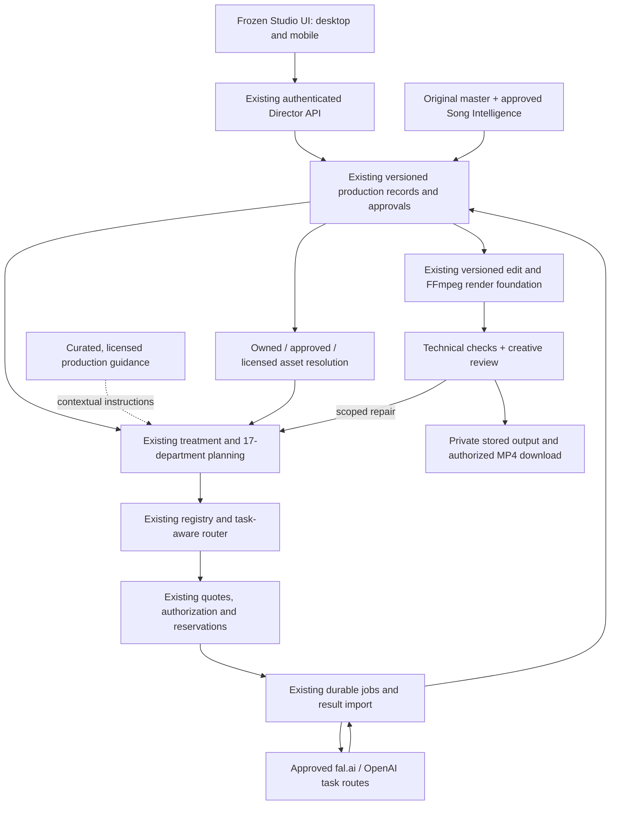

# OpenMontage × Director Studio — Technical Assessment

**Prepared:** 17 November 2026. **Status:** assessment for review; no implementation authorized by this document.

**Confirmed comparison repository:** [OpenMontageInc/OpenMontage](https://github.com/OpenMontageInc/OpenMontage), pinned to `2e003e65fa99a0f329478a2c1cdcf26bc481933a`.

**Director Studio baseline:** [gthawani-del/learningskills](https://github.com/gthawani-del/learningskills), current inspected main `bf51cda57f8f9adc9d937f5b956ecf256e9b956a`. Local worktree was clean when inspected. Deployment and live customer availability were not verified in this assessment.

## 1. Recommendation and boundaries

Use OpenMontage as a source of production methods, capability descriptions, editorial knowledge and selected implementation candidates. Preserve Director Studio as the application, production record authority, authorization boundary and commercial control system.

The most valuable opportunities are:

1. Make the promised output explicit: full-song coverage, original master audio, performance requirements, permitted media types, quality expectations and spending ceiling. Never silently deliver an animatic in place of a performance video.
2. Resolve approved owned assets and appropriately licensed footage before generating replacements. Maintain provenance, continuity and user control over substitutions.
3. Convert relevant production knowledge into bounded departmental guidance: inputs, applicable tasks, tool permissions, output contracts, review and targeted repair.
4. Improve shot-purpose, variation and editing review without imposing arbitrary creative formulas.
5. Strengthen recoverable provider execution and finishing using Director's existing jobs and FFmpeg foundation.

**Do not import the repository wholesale.** Its external coding assistant is the orchestrator; it is not a ready-made hosted agent backend. Its local files, dashboard and cost tracker do not replace Director's multi-user records, permissions, financial controls or frozen UI.

**Licensing is a material adoption gate.** OpenMontage is AGPL-3.0 licensed. Copying its Python, JavaScript, schemas, prompts or skill documents needs an appropriate license decision. An independent implementation of an identified functional requirement is different from copying or translating covered expression. Legal review must determine the obligations of any proposed incorporation; a separate process or API boundary is not an automatic exemption.

Music Video Production remains the locked first release. Movies, advertisements, documentaries/docuseries, micro-dramas and talking avatars remain part of the shared platform. Nothing here reduces their approved scope, changes the frozen UI, introduces a new provider or authorizes spending.

## 2. Evidence and assessment method

The assessment used repository metadata, pinned source files, static Python inspection, pipeline manifests, licenses, Director specifications and recorded verification evidence. No OpenMontage modules were imported or executed. No tests, installs, renders, paid calls, migrations, deployment operations or additional agents were run. The only authored deliverable is this assessment; application files and configurations were not changed.

Use these evidence labels throughout:

| Label | Meaning |
|---|---|
| Source implemented | Relevant logic is present in the inspected commit; not a claim it runs in our environment. |
| Recorded verification | A repository records a test or demonstration; this review did not reproduce it. |
| Documented workflow | Instructions describe a process; execution and quality remain unqualified. |
| Publisher claim | README, example cost or maturity claim, not independently established here. |
| Recommended | Proposed Director integration; not approved implementation or shipped functionality. |

OpenMontage's own `production`, `beta` and `experimental` labels are publisher metadata. Tool names, environment declarations and endpoint strings do not prove current API access, valid pricing, commercial rights, successful output or suitability for singing.

Director's source of truth remains its approved decisions, [Music Video release plan](https://github.com/gthawani-del/learningskills/blob/bf51cda57f8f9adc9d937f5b956ecf256e9b956a/docs/MUSIC_VIDEO_RELEASE_IMPLEMENTATION.md), Model Router Intelligence Bible, Realism Intelligence Layer, shared contracts and frozen UI rules. Earlier baseline descriptions in the release plan must be read with its later dated increments and the current tracker: for example, the older eight-shot/60-second renderer is not the later complete-song assembly proof.

## 3. Whole-system inventory

### 3.1 Repository scale and deduplication

At the pinned OpenMontage revision there are 2,285 tracked files. This includes 236 files under `tools/`, 21 under `lib/`, 11 under `backlot/`, 35 under `schemas/`, 50 under `remotion-composer/`, 30 under `ink-theater/` and 212 under `tests/`. These are file counts, not independently working capabilities or passed tests.

The three knowledge locations contain 1,061 Markdown files: 158 in `skills/`, 580 in `.agents/skills/` and 323 in `.claude/skills/`. Exact-byte hashing yields **719 distinct document bodies** across those locations. This removes exact duplicates only; it does not establish 719 distinct skills. There are 141 paths ending in `/SKILL.md` across tracked files, also subject to duplication. Knowledge files, tool adapters, workflow roles and autonomous agents are different things.

A static inventory examined 248 Python modules in tools/core/board/style areas and collected 184 class records, including source adapters and support classes. Appendix A lists declared named tool/source classes. Metadata extraction encountered optional/empty metadata expressions in three modules; those extraction limitations are not Python syntax failures. Registry discovery was deliberately not executed.

### 3.2 Architectural layers

| Layer | Actual role | Director implication |
|---|---|---|
| Coding assistant + `AGENT_GUIDE.md` | Assistant reads manifests/skills, chooses tools, checkpoints and reviews | Learn bounded operating procedures; do not assume a hosted agent service exists. |
| `pipeline_defs/` | Stage sequence, artifacts, review gates and defaults | Map useful requirements onto existing Director workflows. |
| `skills/`, `.agents/skills/`, `.claude/skills/` | Stage direction, techniques, authoring/runtime knowledge and vendor-specific guidance | Deduplicate by purpose and source; retain license/provenance and versions. |
| `tools/base_tool.py`, registry/selectors | Python execution contracts, dependency checks, capabilities and provider selection | Existing Director registry/router remains authoritative. |
| `lib/` | Scoring, checkpoints, cache, delivery promise, variation, source review, events and configuration | Selectively strengthen existing records and controls. |
| `schemas/` | Artifact, checkpoint, pipeline and selected tool schemas | Crosswalk into existing versioned records, not a second database. |
| `backlot/` | Local FastAPI project board, thumbnails and server-sent progress | Reuse presentation concepts inside frozen Studio panels. |
| Composition and media tools | FFmpeg, Remotion, HyperFrames, animation/3D and provider adapters | FFmpeg first for current release; additional runtimes are conditional. |
| Tests and examples | Contract tests, synthetic evaluations, fixtures and documented showcases | Inform existing targeted QA and acceptance cases; no new framework. |

### 3.3 Pipeline inventory and platform relevance

| Manifest | Repository label | Director relevance and disposition |
|---|---|---|
| `cinematic` | production | **Adapt:** research, shot planning, approved stills before motion and composition guidance. Music timing remains Director-owned. |
| `hybrid` | production | **Adapt:** combine footage, generated media and graphics with explicit purpose. |
| `documentary-montage` | beta | **Adapt later:** source-led evidence, footage and provenance. Do not activate an unrelated format now. |
| `avatar-spokesperson` | production | **Adapt later:** presenter workflow; speech performance does not qualify singing. |
| `talking-head` | beta | **Adapt later:** delivery/performance direction and editing. |
| `animation` | production | **Adapt later:** authored animation and composition practices. |
| `animated-explainer` | production | **Adapt later:** explanatory scenes and graphics; not a replacement music-video workflow. |
| `character-animation` | beta | **Adapt selectively later:** character specifications, rigs, poses and action timelines; not photoreal human identity continuity. |
| `screen-demo` | production | **Reject for current release:** capture-oriented workflow outside music priority; preserve as future knowledge. |
| `clip-factory` | beta | **Adapt later:** repurposing and format outputs, with rights and continuity. |
| `podcast-repurpose` | beta | **Reject for current release:** unrelated source/workflow; useful future transcription/editing knowledge. |
| `localization-dub` | beta | **Adapt later:** multilingual timing and original-source handling; no automatic rewriting or replacing the uploaded song. |
| `framework-smoke` | beta | **Reject as product feature:** test manifest, not a thirteenth customer workflow. |

There are twelve user-facing pipeline manifests plus a framework smoke manifest. There is **no dedicated complete-song, original-master-preserving Music Video pipeline** among them. OpenMontage has relevant building blocks; it does not close our remaining music release deliverables by installation.

### 3.4 What its demonstrations establish

README examples include cinematic clips, product films, stock/source-led work, animation and claimed low source-generation costs. Those show the intended breadth and provide workflow references. A reported 60-second example around $1.33 or a 50-second example around $4 is not a quote for a three-minute, identity-consistent singing video, and may exclude labor, rejected takes, hosting, licenses and rendering.

The BMTS-Lite document records a 21.768-second supplied-footage montage with five source clips, full audio coverage and decode checks. This is recorded technical evidence, not our reproduction and not proof of coherent narrative or good lip sync. The document explicitly says random/balanced clip reuse, no semantic selection and no tool-specific agent visual review. Its referenced fuller BGM integration must not be treated as present merely because a PR is linked.

## 4. Director baseline: existing foundations and open release gates

These observations concern the inspected main commit, not current deployment or live accounts.

| Area | Code/specification evidence | Supported status and remaining qualification |
|---|---|---|
| Shared production engine | `api.mjs`, production-record core, department core/guidance, versioned approvals | Existing shared contracts and selective invalidation; not seventeen autonomous runtime agents. |
| Model routing and financial controls | `model-router.mjs`, `routing-intent.mjs`, task catalog, `spending.mjs`, `cost-quotes.mjs` | Routing/quotes/reservations/jobs and uncertain-charge protections exist. Enabled configurations need current real-provider/schema/price/output qualification. |
| Source ingestion | Source inspection/publication modules and acceptance documents | Private original-source and resumable ingestion code exists; production installation/runtime/account acceptance remains separately gated. The implemented resumable ceiling must not be confused with the active production limit. |
| Song Intelligence | Song signal, analysis/intelligence cores, provider controller/results | Measured properties, evidence/uncertainty, canonical lyrics, review and Director bindings implemented. Actual audio interpretation, singing alignment and model quality are not established by fixtures. |
| Timed treatment and departments | Music treatment modules, proposal adapter, department engine | Full-song timed editable treatment and applicable seventeen-department package implemented and recorded locally verified, including selective revisions. Music-enabled model qualification remains separate. |
| Character/look/location references | Reference production and storyboard cores | Existing approved-asset reuse, exact reference versions and selective shot bindings. Generated character quality and performer rights require actual review. |
| Storyboard and animatic | Storyboard request compiler, frame jobs/import, animatic core/player and `/animatic/from-song` | Music-aware image requests and saved full-song frame-counted animatic implemented. Recorded 180-second/4,320-frame browser evidence uses simulated provider pixels and audio playback fixtures. Not singing or finished video. |
| Full-song render feasibility | `song-render.mjs` and Song Intelligence acceptance | Recorded actual local 180-second supplied-media FFmpeg MP4 proof. Hosted durable customer export is not thereby complete. |
| Singing and final footage | Release deliverables 15/16 | No demonstrated qualified end-to-end singing performance, accepted full-song footage or complete targeted repair loop in recorded current release evidence. |
| Release | Deliverables 2–6, 10, 15–18 and tracker gates | Real accounts/private media/runtime, model activation/quality, durable finishing and complete private pilot remain mandatory. |

Current published work includes reference integration `5face100fc8ffd45da65c2f73f81b1907b6e42fc`, timing bridge `b5f9ce4ef81727e60f22aa23d95dcdf1061aa2c9`, and current music-aware storyboard/animatic head `bf51cda57f8f9adc9d937f5b956ecf256e9b956a`. Earlier Increment 1 publication is `5fc0b3962838fec06cc91344cb155ca4a7dce91c`.

Recorded targeted results include 114 affected reference checks and 82 distinct storyboard/animatic checks with Chromium flows and build evidence. They were **not rerun** here. Their fixture and physical-device limitations remain explicit. No percentage completion is inferred from file or test counts.

## 5. Capability-gap and adoption matrix

**Adopt** means accept the useful requirement/principle, not permission to copy licensed material. **Adapt** means fit a candidate to Director's contracts. **Already Have** means reuse our existing implementation. **Improve** means close a specific deficiency in ours. **Reject** means exclude the proposed incorporation/default, not necessarily discard all future knowledge.

License codes: **A** = OpenMontage AGPL review before copying; **T** = additional third-party/runtime/model terms; **M** = asset-specific rights; **I** = independently implement ideas using existing code, without copying covered expression. Approval of this assessment is not automatic license clearance.

| Component / capability | Decision | Exact fit, dependency or gap | License |
|---|---|---|---|
| Whole OpenMontage application/control plane | Reject | Do not fork/replatform or rely on IDE agents serving customer jobs. | A |
| Stage manifests and transition criteria | Adapt | Add applicable preconditions to existing production stages; use current approvals and versions. | A/I |
| Department knowledge and task instructions | Adapt | Curate relevant techniques into existing seventeen departmental contracts; never load the entire repository per request. | A/T/I |
| Intake and differentiated concepts | Improve | Source-aware creative choices, sensible prefilled assumptions, brief-specific questions; preserve user direction. | A/I |
| Delivery-promise classifier | Adopt | Explicit full-song/master/performance/media agreement stored with approved plan; no silent downgrade. | A/I |
| Universal motion-ratio thresholds | Reject | A 70% motion rule is not universally right for lyric, experimental or deliberately still-led work. | A/I |
| Bespoke art direction | Adapt | Intent, visual references, shot-specific direction and realism; use existing guidance. | A/I |
| Blanket ban on creative-component reuse | Reject | Conflicts with approved reuse and cost strategy; evaluate reuse suitability rather than forbid it. | A/I |
| Reference-video analysis | Adapt | Extract technique and propose original treatments; avoid reproducing protected expression. Existing attachment/source controls apply. | A/T/M |
| Dependency/capability preflight | Improve | Fail before spending when task, reference mode, audio input, schema, credentials or runtime do not qualify. | A/I |
| BaseTool execution wrapper | Already Have | Keep Director operation contracts, job lifecycle and permissions; map useful metadata only. | A/I |
| Python auto-discovery registry | Reject | Do not import arbitrary Python modules into our application or create a second registry. | A |
| Explainable provider scoring | Adapt | Explain task fit, control, continuity and cost using existing router; calibrate with actual outcomes. | A/I |
| Metadata/keyword quality scores | Reject as proof | Heuristic weights are not measured realism, singing accuracy or user preference. | A/I |
| Provider adapter breadth | Adapt selectively | Evaluate task gaps through existing fal/OpenAI access first; exact endpoint/schema/price/terms review before enabling. | A/T |
| Direct extra providers | Reject for current scope | New credentials, contracts and billing are not authorized or needed solely to mirror their catalog. | T |
| Checkpoints and artifact schemas | Already Have | Preserve production-record authority; map useful fields, not JSON directories as parallel state. | A/I |
| Append-only decision history | Improve | Reuse audits/version history; trace affected subject, reason, source and authority. | A/I |
| Local provider-job resume | Adopt | Resume known request IDs after timeouts; never infer failure and blindly resubmit paid work. Existing jobs/fencing remain. | A/I |
| Local floating-point cost tracker | Reject | Keep durable integer money/reservations/reconciliation. File overwrite is not a multi-user financial ledger. | A |
| Cache keys and immutable output reuse | Improve | Existing assets/jobs; add source/model/config/version and access scope to reuse decisions. | A/I |
| Local cache directory/LRU as shared store | Reject | Not cloud durability, tenant isolation or cross-machine recovery. | A |
| Stock/direct footage acquisition | Adapt | Existing private import, provenance, per-asset licensing, review; external API access needs approval if new. | A/T/M |
| CLIP corpus and diverse retrieval | Adapt conditionally | Begin with current metadata/owned assets. Torch/Transformers corpus runtime is optional and requires justified dependencies. | A/T/M |
| Footage-motion and source-kind filters | Improve | Match B-roll vs performer footage; exclude incompatible identities, rights and repeated source ranges. | A/I/M |
| Audio probe/energy/onset helpers | Already Have | Song signal/worker code already measures properties. Compare missing requirements; do not duplicate analysis. | A/I |
| Speech transcription/forced alignment | Adapt selectively | Existing song provider path; evaluate singing, language, overlap and uncertain boundaries, not just clear speech. | A/T |
| Source silence cutting | Reject on master song | No silence removal, time stretching or section shortening without explicit user-directed edit. | A/I |
| Voice-performance guidance | Adapt | Applies to casting/expression when relevant; uploaded singer is not replaced by default TTS. | A/I/T |
| Avatar/lip-sync adapters | Adapt after qualification | Require exact singing/audio/reference support, identity, duration, pose and commercial permission. | A/T/M |
| Face restoration and enhancement | Adapt only if needed | May alter identity/skin/teeth or realism; review original vs processed, preserve both. | A/T |
| BMTS-Lite full-track assembly | Adapt workflow only now | Useful timing/decode/artifact requirements; existing FFmpeg handles supplied-media proof. Extra Python3.11 engine is not approved. | A/T |
| Random balanced clip assignment | Reject as Director default | Does not ensure lyric meaning, story, continuity or performer relevance. | A/I |
| Reference-guided professional BGM workflow | Assess later | Linked external integration/PR is not sufficient evidence it is in this main or qualified. | A/T |
| Shot prompt builder | Adapt | Feed exact approved identity, location, action, camera, lighting and shot purpose from current contracts. | A/I |
| Variation/slideshow-risk checks | Adapt as advisory | Flag accidental monotony; support intentional repetition, static takes and consistent lighting. | A/I |
| Scene-pacing validation | Improve | Source timing and edit intent, exact song endpoints, legal trims; avoid mandatory cut-on-every-beat. | A/I |
| Visual technical QA | Adapt | Probe/decode/levels/frame sampling; not proof of realism, identity or lip-sync quality. | A/I |
| Synthetic evaluation plans | Adapt cases | Add relevant cases to current tests; synthetic plan success does not equal generated-video quality. | A/I |
| Reviewer instructions | Adapt | Separate technical, musical, visual, rights and customer-direction checks; preserve calibrated human review. | A/I |
| FFmpeg assembly/mixing/reframe | Improve | Existing render foundation; versioned edit decisions, master clock, output validation and recovery. | A/T/I |
| Automatic crop/blur-fill | Adapt as explicit option | Protect faces/action/product; user approval where framing changes composition. | A/I |
| Remotion composition | Defer / Adapt conditionally | Useful deterministic graphics; commercial licensing/runtime review; do not introduce for tasks FFmpeg already satisfies. | A/T |
| HyperFrames/GSAP authoring | Defer / Adapt conditionally | Bespoke graphics potential; code-execution/security/dependency review and measurable need first. | A/T |
| Arbitrary generated composition code | Reject as default | Untrusted code cannot get server secrets or unrestricted network/filesystem access. | A/T |
| Subtitles and deterministic typography | Improve | Render canonical lyrics with actual alignment/font coverage; keep text out of image generation masters. | A/T/I |
| Blender/Three.js/Manim/character rigs | Defer | Preserve future applicability; not prerequisites to first complete Music Video release. | A/T |
| Backlot local board | Reject replacement; Adapt views | Use existing three desktop panels/mobile layout for progress, takes and costs. Local loopback app is not our SaaS. | A/T |
| Export bundle/reporting | Adapt | MP4 plus optional edit/rights/cost manifest through existing private outputs/downloads. | A/I/M |
| New QA framework or infra | Reject | Existing Node/Chromium/FFmpeg/CI mechanisms are sufficient; extend affected cases only. | — |
| Fixed research quotas/budgets/end cards | Reject | No mandatory eight searches, inherited $2 cap, philosophical closing or music insertion regardless of brief. | A/I |

## 6. Production intelligence mapped to all seventeen departments

Each department contributes when applicable. This is one coordinated production package, not seventeen compulsory customer approvals. “Not applicable” needs a reason; it is not permission to omit a required responsibility.

| Existing department | OpenMontage learning to evaluate | Required Music Video output / guardrail |
|---|---|---|
| Producing | Capability preflight, delivery promise, path scoring | Full-song scope, asset strategy, quote/ceiling, finishing reserve, risks and production dependencies. |
| Direction | Concept/proposal/taste/reference guidance | Coherent treatment and visual language driven by song meaning and approved intent. |
| Script breakdown | Scene/asset artifacts | Timed sequences and shot purposes with lyric/section evidence; no invented transcription. |
| Casting | Voice/performance and character guidance | Performer identities, singer assignments, consent and approval; original vocal retained. |
| Look | Style playbooks/character specifications | Approved identity/outfit/appearance references and versioned realism constraints. |
| Locations | Source acquisition/world/reference knowledge | Consistent approved places; licensed B-roll suitability and provenance. |
| Camera | Shot prompt builder and variation | Framing/movement/coverage matched to action; face visibility compatible with singing route. |
| Lighting | Cinematic technical knowledge | Physically coherent lighting across takes; deliberate variation instead of forced variety. |
| Voice | Performance director and speech tool knowledge | Preserve recorded singing; only separately authorized added dialogue/voice tasks. |
| Sound | Probe/mix/enhance techniques | Original master integrity, no unintended generated dialogue, controlled optional SFX/ambience. |
| Music | Energy/pacing/montage analysis | Approved section/phrase map, uncertain timing, instrumental/vocal distinction and emotional progression. |
| Continuity | Cache/provenance/reviewer practices | Identity, outfit, place, screen direction, movement and source-version continuity; repair affected scope. |
| Storyboard | Scene-plan and source-review guidance | Actual reviewed frames for timed shots, approved references and media strategy. |
| Animatic | Full-track montage/timing checks | Full requested range, original master, exact cumulative frame boundaries and approved frame versions. |
| VFX | Graphics/compositor/character techniques | Deliberate effects and canonical lyric overlays; no unapproved stylization or default CGI look. |
| Editorial | Edit decisions, retrieval, pacing, reframe | Take selection, trims, cut reasons, sync, source range reuse, transitions and master-preserving final timeline. |
| Rights | Source/asset manifests | Song, likeness, performer, location, stock/font/model permissions and attributable provenance. |

## 7. Unified integration architecture

This is a proposed integration view of existing responsibilities. It adds no second application, database, queue, provider account, agent framework or render infrastructure.

### 7.1 Authority and contract mapping

| OpenMontage representation | Director authority to retain | Proposed information worth preserving |
|---|---|---|
| `brief`, research/proposal packets | Existing brief, song analysis and approved creative decisions | Evidence references, uncertainty, alternatives, delivery promise and rejection reasons. |
| `script`, `scene_plan` | Timed music treatment, department output and `music_video_plan_v1` | Stable shot IDs, exact original-master ranges, role, purpose, action, camera and acceptance criteria. |
| Asset/source-review manifests | Existing library/reference/take records | Asset ID/version, rights, source range, performer identity, compatibility and reuse constraints. |
| Edit decisions / action timeline | Existing versioned edit contracts | Selected take, in/out, timeline interval, transition and protected master-audio reference. |
| Checkpoint / decision log | Existing run state, approvals and audit | State/version, approving authority, changed subject, reasons, pending dependencies. |
| Cost log | Existing durable spending records | Estimate, exposure, actual settlement and explicitly identified missing price. No replacement ledger. |
| Render / review / publish reports | Existing render jobs and private output records | Exact plan/input versions, output checksum, technical measurements, review and download authorization. |

Any additional fields require compatibility with existing records and old projects. Do not independently copy their JSON schemas and then synchronize two competing models. Existing approval does not become invalid merely because an optional advisory check is added. A changed source/version must trigger the existing selective-review rules.

### 7.2 Bounded Director behavior and tools

If adaptive agent execution is approved later, the suitable pattern is one bounded Director using department skills and existing tools. Deterministic stage guards control state transitions, permissions, source currentness, spend and retry limits. The model proposes plans, diagnoses failures and suggests permitted actions; it cannot manufacture approvals or billing authority.

This is a recommendation, not a claim an autonomous Director agent is already shipped. OpenMontage’s external IDE assistant demonstrates a way to consume production instructions; it does not establish seventeen autonomous agents or a safe multi-tenant server loop.

Each contextual skill should identify applicability, required evidence/assets, allowed operations, output contract, review criteria and failure/repair path. Retrieve only relevant guidance. Treat imported scripts, lyrics, prompts, filenames and web content as untrusted data rather than instructions to bypass controls.

### 7.3 Model-router intelligence

Retain current fal/OpenAI routing and admin registry. A candidate route must first satisfy hard constraints: exact task and media input, singing vs speech, reference conditioning, supported duration/resolution/languages, commercial availability, current schema, price and authorized runtime. Only then rank task fit, quality evidence, continuity/control, expected accepted cost, latency and reliability.

OpenMontage's scoring weights and keyword matching are useful explainability examples, not universal truth or empirical quality measurements. Unknown capability remains unknown. Record configuration-specific qualification, source/date and failure modes. Keep low-cost routes such as appropriate Wan/Flux-family candidates in consideration when they satisfy the job; do not make either cheapest-model or premium-model selection universal.

Named OpenMontage adapters for Kling, Seedance, Wan, LTX, Sora and others are discovery leads. They are not qualified Director singing routes. Verify actual endpoint support for the intended input/performance and assess outputs before activation. A general video model that generates a moving mouth is not automatically an exact-audio lip-sync model.

## 8. Music Video workflow after selective integration

The intended customer journey remains the approved one, implemented incrementally through existing screens:

1. **Upload and preserve:** retain original MP3/WAV/master bytes and provenance; inspect the source and save it privately. Confirm intended duration/aspect/output and supplied lyrics or references.
2. **Understand:** deterministic properties first; qualified audio models for interpretation/transcription/alignment. Show uncertain section or word timing for correction. Instrumental tracks and multiple singers remain supported cases, not exceptions forced into one vocalist.
3. **Treat and approve:** complete-song visual treatment uses actual structure, lyrical meaning and emotional progression. Performance, narrative, dance, B-roll and graphics are purposeful choices, not mandatory equal percentages.
4. **Resolve assets and budget:** match approved characters, looks, locations and existing media before paid generation. Explain alternatives and whole-plan expected exposure. Separate treatment approval from generation spending authority.
5. **Storyboard and animatic:** produce actual reviewed frames and a full-song preview using the original audio. Approve expensive motion/performance direction against that plan. An animatic remains a planning artifact.
6. **Qualify performance:** choose the hardest representative singing excerpt, including articulation, expressive change and intended framing. Check exact original audio, singer/face assignment, mouth timing, teeth/tongue artifacts, identity, motion and emotion. No full-song batch before the route/configuration and representative result are accepted.
7. **Produce footage:** use approved assets, shot-specific route decisions, narrative/performance coverage and suitable B-roll. Maintain precise source-to-song timing and immutable take history. Do not use unrelated stock faces as singer substitutes.
8. **Editorial assembly:** editor selects accepted takes, trims performance to the approved clock, cuts for meaning and musical progression, balances repeated choruses with deliberate variety, protects identity and manages transitions. Beat snapping is optional; the strongest cut may be a phrase, gesture or emotional change.
9. **Targeted repair:** diagnose whether the defect is source alignment, face visibility, route choice, take quality or editorial placement. Repair only affected ranges. Preserve approved neighbors and original audio; honor existing two-attempt limits and surface an honest stop/decision when unresolved.
10. **Finish and deliver:** deterministic canonical lyrics/titles where requested, explicit aspect handling, correct audio mix, complete decode, timing and continuity checks, reviewed private downloadable MP4. Retain versions, costs and recovery evidence.

No source tool's default narration, music replacement, random footage assignment, shortening or closing-card rule may override this journey.

## 9. Cost-per-finished-video strategy

The commercial objective is lower **accepted finished-output cost**, not a low advertised first-generation price. The user's reported $50–70 competitor range is a useful market observation, not an independently verified current price or our guaranteed target.

Calculate actual project cost from analysis/planning, newly generated and rejected assets, performance/lip-sync, permitted stock/licenses, repair attempts, processing/rendering, storage/egress and applicable platform fees. Show provider cost separately from customer price, credits/tax and margin. Track currency and tariff/version; unknown charges or pending work are exposure, not zero.

Recommended optimizations, in order:

1. Reuse exact approved outputs and source ranges where creatively suitable and authorized.
2. Correct cheap references/alignment and review singing proofs before expensive batches.
3. Allocate premium routes to shots whose requirements need them; use qualified economical routes elsewhere.
4. Use deterministic crops, transitions, typography, waveform and technical checks instead of paying a generative model for measurable operations.
5. Use licensed B-roll when it fits meaning/continuity; record license and commercial permission.
6. Repair the defective shot/range rather than rerender the project; resume known provider jobs rather than resubmit after uncertain timeouts.
7. Preserve a finishing reserve and pause before unaffordable work, rather than produce an incomplete film after consuming the budget.

Display spent, reserved/pending, estimated remaining-to-finish and ceiling through existing cost controls. A route or scope change updates the quote and authority before execution. A cache hit avoids regeneration charges but can still incur storage/egress/compute; do not count it as a cash refund.

Measure accepted seconds per dollar, paid rejects, first/second-attempt acceptance, exact-asset reuse, authorized plan-to-actual variance, repair locality and time/cost to a complete approved output. Neither OpenMontage's showcase costs nor its heuristic scores establish our savings. Compare equivalent duration, quality, performance share and inclusion of retries before making competitive claims.

## 10. Quality, guardrails and evaluation

### Deterministic hard gates

- Correct owner/project/private-source authorization and valid source checksums/versions.
- Full requested song range with continuous timeline coverage, exact cumulative frame calculation and original-master reference.
- Valid trim ranges, bounded assets and no unauthorized master replacement, time stretch or automatic silence removal.
- Current required approvals, applicable department outputs, quote/reservation and no emergency shutdown violation.
- No duplicate paid submission on a recoverable timeout; uncertain cost prevents unapproved further exposure.
- Output decode, expected codecs/dimensions/aspect, audio presence, playable duration and bounded A/V drift against defined frame/container tolerances.
- Correct canonical text, coverage and font shaping for requested languages; do not silently rewrite lyrics to fit timing.

### Perceptual and musical acceptance

Lip sync, realism, expression, visual storytelling, lyrical relevance and identity continuity need actual footage and listening/viewing. Energy peaks do not prove choruses; speech transcription does not prove singing alignment; technical frame sampling does not prove artistic quality.

Use reviewed examples spanning intended supported languages, vocal styles, instrumental tracks, multiple singers, tempo changes and ambiguous structure. A reference-conditioned singer close-up is a different qualification from a wide narrative shot. Establish explicit output/rater acceptance for each enabled route rather than asserting one universal quality score.

OpenMontage's synthetic plan benchmark and replay scaffolding are useful case sources. They are not a demonstrated comprehensive generated-media evaluation suite. Its `visual_qa` technical checks must not be described as a proven identity or singing detector. Variation rules should warn with reasons and support intentional exceptions; constant lighting or a long take can be excellent direction.

Use current targeted Node/Chromium checks for changed behavior and existing FFmpeg fixtures for technical rendering. Broader existing regression checks belong at integration/release boundaries. Real-provider reviews occur only after explicit spending authorization. Desktop mobile viewports never establish physical-device acceptance. The two-attempt quality objective remains a measured target, not a guarantee.

## 11. Licensing, security and operational risks

| Risk | Evidence / implication | Required mitigation or decision |
|---|---|---|
| AGPL incorporation | Root license and repository metadata are AGPL-3.0. Modified covered network software can carry source-offer obligations under section 13; distribution and combination need analysis. | Review proposed copied components and business license posture or obtain suitable alternative rights. Reading ideas alone does not automatically put existing Director under AGPL. |
| BMTS-Lite separate engine | OpenMontage docs identify a separate checkout/Python3.11 environment and AGPL-3.0-only current source. | Separate source/license/runtime review; do not assume wrapper use clears engine obligations. No installation recommended now. |
| Other third-party terms | Remotion, HyperFrames/dependencies, model weights, fonts, SFX and mocap have their own terms. | Review exact versions and notices; no blanket “open source means commercially free.” Root license cannot grant third-party asset rights. |
| Avatar/model permissions | Local Wav2Lip/SadTalker/restoration adapters may involve separate code, checkpoint and training-data terms. | Confirm exact artifact rights and consent before commercial activation; no assumption that an adapter grants permission. |
| Stock provenance | Seventeen source adapters include archives, agencies and commercial aggregators. Their assets are not uniformly public domain or commercially reusable. | Persist asset-specific license/source/date/attribution/releases; enforce editorial-only and restricted usage. |
| Financial concurrency | `cost_tracker._save()` writes a local JSON file; float accounting and warn-mode defaults are not our transactional ledger. | Keep Director's integer durable reservations/reconciliation; do not import permissive defaults. |
| Download boundaries | `provider_jobs.download()` accepts HTTPS or base64 and buffers content; this helper does not itself enforce our host/redirect/byte controls. | Retain existing bounded private import; explicit MIME/decode/size/hash checks and safe URL resolution. This is a helper-specific observation, not an exploit claim. |
| Untrusted composition code | Agent-authored React/HTML/JS or shell tools can execute arbitrary code. | No direct code execution in customer request handlers or with secrets. Use approved existing templates/runtime boundaries; new sandbox work needs approval. |
| Tenant cache leakage | Content-only reuse keys or local corpus browsing can cross permissions. | Scope reuse to authorized assets/tenants and current rights; preserve revocation and retention rules. |
| Local board exposure | Backlot binds loopback by default; its local project-file model is not a demonstrated hosted tenant permission system. | Do not expose it as customer Studio or a second public application. |
| Heuristic authority | Variation thresholds, scoring weights and generic style guidance can conflict with artistic intent. | Advisory status and explicit rationale; approved brief and user decisions retain authority. |
| Dependency and context bloat | Hundreds of knowledge pages, multiple runtimes/providers and duplicate agent distributions. | Curate small task-relevant guidance, retain provenance and reject unsupported runtime additions. |
| Incomplete provider equivalence | Speech avatar, talking head, lip sync and general video generation are distinct tasks. | Capability-qualified song/performance route and real excerpt review before batching. |
| Overstated evidence | Publisher examples, fixture tests and local proofs can be mistaken for production acceptance. | Keep implemented/local/live/creative states separate in tracker and release reporting. |

Ink Theater's notices identify Patrick Hand under SIL OFL and CMU-derived mocap with source trial IDs. Remotion composer also contains font notices. Those examples show why attribution must be tracked per component. They do not clear every bundled asset or renderer dependency. Bundled SFX credits and separately licensed skill families also require review before reuse.

## 12. Phased execution roadmap for review

These phases organize the existing eighteen deliverables; they do not replace them. Relative effort is an estimate, not a delivery promise. No phase starts solely because this assessment exists.

| Phase | Work and reuse | Existing release deliverables | Acceptance evidence | Relative effort / dependency |
|---|---|---|---|---|
| 0. Approve selective incorporation | Choose requirements/knowledge to use; decide license posture for copied material; preserve pinned provenance. | 1, with all approved scope preserved | Reviewed component decisions and no unidentified copied dependencies. | Small for independent requirements; legal timing external. |
| 1. Strengthen current asset/delivery handoff | Use existing approved plan, references, frame/animatic contracts and cost panels. Add only missing delivery constraints, reuse provenance and explainable holds. | 7–9, 12–14 | Existing complete-song project preserves master and approvals; compatible owned assets avoid generation; proposed substitution is reviewable and re-quoted. | Small/medium; depends on exact existing contract gaps. No new runtime. |
| 2. Qualified singing route and representative proof | Existing registry, fal/OpenAI access, jobs, reservation and private import; exact audio excerpt/performer/timing; preserve master. | 10, 15, informed by 11–14 | Actual authorized excerpt reviewed for sync, expression, identity, motion and charge; failures diagnosed and scoped. | Medium; real endpoint/configuration/price qualification and spend approval. |
| 3. Footage, B-roll and selective repair | Existing shot/take records and reference approvals; approved reuse first, task-specific generation and rights-checked import. Add missing editorial take/range selection using existing UI. | 8–10, 13–16 | Complete intended song coverage with accepted media, provenance, costs and preserved neighboring approvals after repair. | Larger creative/integration work; depends on accepted performance proof and assets. |
| 4. Complete-song finishing and hosted delivery | Extend existing FFmpeg/edit/job foundation; original audio, deterministic text, mixing, validation, recovery and private MP4. | 3–6, 17 | Actual full-song stored/downloadable output; decode, A/V timing, reload/recovery and owner access verified. | Medium/larger; cloud schema/runtime/private-transfer approval and qualification remain external gates. |
| 5. Private pilot and release acceptance | Existing QA/CI, support/admin/spending controls and complete-song examples. | 2, 9–10, 18 plus all preceding dependencies | Finished reviewed projects, actual charge reconciliation, recovery/isolation and physical-device evidence. | Depends on complete production chain, not test count. |
| 6. Shared-format propagation later | Reuse accepted source/asset/shot/cost/edit/quality mechanisms with format-specific planning. | Wider approved platform roadmap | Format-specific pilots preserve shared contracts and add only genuine differences. | After Music Video priority; no parallel unrelated format build. |

Cloud activation work can proceed independently only within existing approval. Missing hosted access must not prevent independent code completion, but local completion must not be labeled hosted acceptance. Do not repeat unchanged Vercel failures or switch scopes without evidence. GitHub main remains the publication workflow when implementation is separately approved; Vercel deploys automatically.

Suggested implementation order after approval is **delivery/reuse gaps → real singing proof → accepted footage and B-roll → final editorial/full-song export → private pilot**. Continue the existing code rather than reinstall Song Intelligence, departments, references or animatics.

### Preservation of all eighteen release deliverables

1. Checklist/baseline; 2. cloud accounts/recovery; 3. resumable ingestion; 4. authorized processing-runtime proof; 5. durable processing; 6. hosted uploaded-asset export; 7. music-source department adapter; 8. assets before generation; 9. cost indicator; 10. model-route qualification; 11. Song Intelligence; 12. treatment/departments; 13. character/reference integration; 14. costed storyboard/animatic; 15. singing proof; 16. footage/B-roll/repairs; 17. final editor/render; 18. private pilot/release.

Earlier code increments advance several deliverables. None of OpenMontage's manifests or example videos eliminates the corresponding live/creative acceptance requirements.

## 13. Decisions needed before implementation

1. Approve or amend this selective adoption assessment. No blanket repository import is recommended.
2. Choose the legal route before incorporating covered code, schemas or skill prose: compatible compliance, suitable alternative permission, or independent requirements-led implementation with no copying. Legal interpretation is outside this technical review.
3. Authorize specific paid route qualification, processing proof and production migrations when their concrete scope/cost is presented. Existing planning ceilings are not permission to spend.
4. Confirm optional third-party stock access or additional composition/ML runtime only if a demonstrated requirement cannot be met through existing capabilities. None is proposed as a prerequisite now.

No decision is needed on changing first priority, reducing scope, redesigning the UI, selecting new infrastructure or replacing the existing engine: those choices remain locked as instructed.

## 14. Source references

All relative OpenMontage references in Appendix A refer to the pinned revision below. All Director observations refer to its pinned main. README links sometimes use the previous `calesthio` location; repository identity here follows the user-confirmed organization and commit.

### OpenMontage primary sources

- [Repository and README](https://github.com/OpenMontageInc/OpenMontage/tree/2e003e65fa99a0f329478a2c1cdcf26bc481933a)
- [Architecture](https://github.com/OpenMontageInc/OpenMontage/blob/2e003e65fa99a0f329478a2c1cdcf26bc481933a/docs/ARCHITECTURE.md)
- [Agent guide](https://github.com/OpenMontageInc/OpenMontage/blob/2e003e65fa99a0f329478a2c1cdcf26bc481933a/AGENT_GUIDE.md)
- [AGPL license](https://github.com/OpenMontageInc/OpenMontage/blob/2e003e65fa99a0f329478a2c1cdcf26bc481933a/LICENSE)
- [Pipeline manifests](https://github.com/OpenMontageInc/OpenMontage/tree/2e003e65fa99a0f329478a2c1cdcf26bc481933a/pipeline_defs)
- [Production skills](https://github.com/OpenMontageInc/OpenMontage/tree/2e003e65fa99a0f329478a2c1cdcf26bc481933a/skills)
- [Scoring](https://github.com/OpenMontageInc/OpenMontage/blob/2e003e65fa99a0f329478a2c1cdcf26bc481933a/lib/scoring.py), [delivery promise](https://github.com/OpenMontageInc/OpenMontage/blob/2e003e65fa99a0f329478a2c1cdcf26bc481933a/lib/delivery_promise.py), [variation](https://github.com/OpenMontageInc/OpenMontage/blob/2e003e65fa99a0f329478a2c1cdcf26bc481933a/lib/variation_checker.py)
- [Asset cache](https://github.com/OpenMontageInc/OpenMontage/blob/2e003e65fa99a0f329478a2c1cdcf26bc481933a/lib/asset_cache.py), [provider jobs](https://github.com/OpenMontageInc/OpenMontage/blob/2e003e65fa99a0f329478a2c1cdcf26bc481933a/tools/provider_jobs.py), [cost tracker](https://github.com/OpenMontageInc/OpenMontage/blob/2e003e65fa99a0f329478a2c1cdcf26bc481933a/tools/cost_tracker.py)
- [Clip retrieval](https://github.com/OpenMontageInc/OpenMontage/blob/2e003e65fa99a0f329478a2c1cdcf26bc481933a/tools/video/clip_search.py), [source adapters](https://github.com/OpenMontageInc/OpenMontage/tree/2e003e65fa99a0f329478a2c1cdcf26bc481933a/tools/video/stock_sources)
- [BMTS-Lite documentation](https://github.com/OpenMontageInc/OpenMontage/blob/2e003e65fa99a0f329478a2c1cdcf26bc481933a/docs/bgm-montage-lite.md), [adapter](https://github.com/OpenMontageInc/OpenMontage/blob/2e003e65fa99a0f329478a2c1cdcf26bc481933a/tools/video/bmts_lite.py)
- [Technical visual QA](https://github.com/OpenMontageInc/OpenMontage/blob/2e003e65fa99a0f329478a2c1cdcf26bc481933a/tools/analysis/visual_qa.py), [evaluation material](https://github.com/OpenMontageInc/OpenMontage/tree/2e003e65fa99a0f329478a2c1cdcf26bc481933a/tests/eval)
- [Backlot](https://github.com/OpenMontageInc/OpenMontage/tree/2e003e65fa99a0f329478a2c1cdcf26bc481933a/backlot), [Remotion package](https://github.com/OpenMontageInc/OpenMontage/blob/2e003e65fa99a0f329478a2c1cdcf26bc481933a/remotion-composer/package.json), [Ink Theater notices](https://github.com/OpenMontageInc/OpenMontage/blob/2e003e65fa99a0f329478a2c1cdcf26bc481933a/ink-theater/THIRD_PARTY_NOTICES.md)

### Director primary sources

- [Current pinned code](https://github.com/gthawani-del/learningskills/tree/bf51cda57f8f9adc9d937f5b956ecf256e9b956a/apps/director)
- [Development tracker](https://github.com/gthawani-del/learningskills/blob/bf51cda57f8f9adc9d937f5b956ecf256e9b956a/docs/DEVELOPMENT_TRACKER.md)
- [Eighteen-deliverable release plan](https://github.com/gthawani-del/learningskills/blob/bf51cda57f8f9adc9d937f5b956ecf256e9b956a/docs/MUSIC_VIDEO_RELEASE_IMPLEMENTATION.md)
- [Model Router Intelligence Bible](https://github.com/gthawani-del/learningskills/blob/bf51cda57f8f9adc9d937f5b956ecf256e9b956a/docs/MODEL_ROUTER_INTELLIGENCE_BIBLE.md)
- [Realism Intelligence Layer](https://github.com/gthawani-del/learningskills/blob/bf51cda57f8f9adc9d937f5b956ecf256e9b956a/docs/REALISM_INTELLIGENCE_LAYER.md)
- [Frozen UI implementation rules](https://github.com/gthawani-del/learningskills/blob/bf51cda57f8f9adc9d937f5b956ecf256e9b956a/docs/STUDIO_UI_IMPLEMENTATION_RULES.md)
- [Song Intelligence acceptance](https://github.com/gthawani-del/learningskills/blob/bf51cda57f8f9adc9d937f5b956ecf256e9b956a/docs/SONG_INTELLIGENCE_ACCEPTANCE.md), [provider qualification](https://github.com/gthawani-del/learningskills/blob/bf51cda57f8f9adc9d937f5b956ecf256e9b956a/docs/SONG_INTELLIGENCE_PROVIDER_ACCEPTANCE.md)
- [Reference evidence](https://github.com/gthawani-del/learningskills/blob/bf51cda57f8f9adc9d937f5b956ecf256e9b956a/docs/evidence/MUSIC_REFERENCES_2026-11-16.json), [storyboard/animatic evidence](https://github.com/gthawani-del/learningskills/blob/bf51cda57f8f9adc9d937f5b956ecf256e9b956a/docs/evidence/MUSIC_STORYBOARD_ANIMATIC_2026-11-16.json)

## Appendix A. Static declared-tool and source-adapter inventory

The following catalog supplements the subsystem decisions in Section 5. It is not a list of installed, enabled, licensed or verified routes. Values are declared metadata only; missing metadata is recorded as unspecified, not absent capability. Dependencies may also be resolved dynamically and are not exhaustively proven by static declarations. Third-party terms remain additional to root AGPL obligations.

| Source module | Declared name | Provider | Capability | Declared prerequisites | Proposed treatment | License gates |
|---|---|---|---|---|---|---|
| tools/analysis/audio_energy.py | audio_energy | ffmpeg | analysis | binary:ffmpeg | Already Have / Improve: compare specific analysis gap | A + T |
| tools/analysis/audio_probe.py | audio_probe | ffprobe | analysis | binary:ffprobe | Already Have / Improve: compare specific analysis gap | A + T |
| tools/analysis/azure_stt.py | azure_stt | azure | analysis | No static prerequisites declared; runtime review required | Already Have / Improve: compare specific analysis gap | A + T |
| tools/analysis/composition_validator.py | composition_validator | local | analysis | binary:ffprobe | Already Have / Improve: compare specific analysis gap | A + T |
| tools/analysis/dashscope_asr.py | dashscope_asr | dashscope | analysis | No static prerequisites declared; runtime review required | Already Have / Improve: compare specific analysis gap | A + T |
| tools/analysis/face_tracker.py | face_tracker | mediapipe | analysis | cmd:ffmpeg | Already Have / Improve: compare specific analysis gap | A + T |
| tools/analysis/frame_sampler.py | frame_sampler | ffmpeg | analysis | cmd:ffmpeg | Already Have / Improve: compare specific analysis gap | A + T |
| tools/analysis/mistral_stt.py | mistral_stt | mistral | analysis | env:MISTRAL_API_KEY | Already Have / Improve: compare specific analysis gap | A + T |
| tools/analysis/scene_detect.py | scene_detect | ffmpeg | analysis | cmd:ffmpeg | Already Have / Improve: compare specific analysis gap | A + T |
| tools/analysis/transcriber.py | transcriber | whisperx | analysis | python:faster_whisper | Already Have / Improve: compare specific analysis gap | A + T |
| tools/analysis/transcript_fetcher.py | transcript_fetcher | youtube-transcript-api | analysis | python:youtube_transcript_api | Already Have / Improve: compare specific analysis gap | A + T |
| tools/analysis/video_analyzer.py | video_analyzer | multi | analysis | cmd:ffmpeg | Already Have / Improve: compare specific analysis gap | A + T |
| tools/analysis/video_downloader.py | video_downloader | yt-dlp | source_ingest | python:yt_dlp | Already Have / Improve: compare specific analysis gap | A + T |
| tools/analysis/video_understand.py | video_understand | transformers | analysis | python:transformers, python:torch | Already Have / Improve: compare specific analysis gap | A + T |
| tools/analysis/visual_qa.py | visual_qa | ffmpeg | analysis | cmd:ffmpeg, cmd:ffprobe | Already Have / Improve: compare specific analysis gap | A + T |
| tools/audio/audio_enhance.py | audio_enhance | ffmpeg | audio_processing | cmd:ffmpeg | Already Have / Improve: existing edit/render contracts | A + T |
| tools/audio/audio_mixer.py | audio_mixer | ffmpeg | audio_processing | cmd:ffmpeg | Already Have / Improve: existing edit/render contracts | A + T |
| tools/audio/azure_tts.py | azure_tts | azure | tts | No static prerequisites declared; runtime review required | Adapt candidate metadata only; existing providers first | A + T |
| tools/audio/cartesia_tts.py | cartesia_tts | cartesia | tts | env:CARTESIA_API_KEY | Adapt candidate metadata only; existing providers first | A + T |
| tools/audio/comfyui_music.py | comfyui_music | comfyui | music_generation | No static prerequisites declared; runtime review required | Adapt candidate metadata only; existing providers first | A + T |
| tools/audio/dashscope_tts.py | dashscope_tts | dashscope | tts | No static prerequisites declared; runtime review required | Adapt candidate metadata only; existing providers first | A + T |
| tools/audio/doubao_tts.py | doubao_tts | doubao | tts | No static prerequisites declared; runtime review required | Adapt candidate metadata only; existing providers first | A + T |
| tools/audio/elevenlabs_soundtrack.py | elevenlabs_soundtrack | elevenlabs | music_generation | env:ELEVENLABS_API_KEY | Adapt candidate metadata only; existing providers first | A + T |
| tools/audio/elevenlabs_tts.py | elevenlabs_tts | elevenlabs | tts | No static prerequisites declared; runtime review required | Adapt candidate metadata only; existing providers first | A + T |
| tools/audio/fal_elevenlabs_music.py | fal_elevenlabs_music | fal.ai | music_generation | env:FAL_KEY | Adapt candidate metadata only; existing providers first | A + T |
| tools/audio/fal_elevenlabs_tts.py | fal_elevenlabs_tts | fal.ai | tts | env:FAL_KEY | Adapt candidate metadata only; existing providers first | A + T |
| tools/audio/fish_audio_tts.py | fish_audio_tts | fish_audio | tts | env:FISH_AUDIO_API_KEY | Adapt candidate metadata only; existing providers first | A + T |
| tools/audio/freesound_music.py | freesound_music | freesound | music_search | No static prerequisites declared; runtime review required | Adapt candidate metadata only; existing providers first | A + T |
| tools/audio/gemini_tts.py | gemini_tts | gemini | tts | No static prerequisites declared; runtime review required | Adapt candidate metadata only; existing providers first | A + T |
| tools/audio/google_music.py | google_music | google | music_generation | No static prerequisites declared; runtime review required | Adapt candidate metadata only; existing providers first | A + T |
| tools/audio/google_tts.py | google_tts | google_tts | tts | No static prerequisites declared; runtime review required | Adapt candidate metadata only; existing providers first | A + T |
| tools/audio/grok_tts.py | grok_tts | grok | unspecified | env:XAI_API_KEY | Adapt candidate metadata only; existing providers first | A + T |
| tools/audio/heygen_catalog_tts.py | heygen_catalog_tts | heygen | unspecified | env:HEYGEN_API_KEY | Adapt candidate metadata only; existing providers first | A + T |
| tools/audio/heygen_tts.py | heygen_tts | heygen | unspecified | env:HEYGEN_API_KEY | Adapt candidate metadata only; existing providers first | A + T |
| tools/audio/heygen_voice_convert.py | heygen_voice_convert | heygen | voice_conversion | env:HEYGEN_API_KEY | Adapt candidate metadata only; existing providers first | A + T |
| tools/audio/inworld_tts.py | inworld_tts | inworld | tts | env:INWORLD_API_KEY | Adapt candidate metadata only; existing providers first | A + T |
| tools/audio/kling_tts.py | kling_tts | kling_official | tts | env:KLING_API_KEY | Adapt candidate metadata only; existing providers first | A + T |
| tools/audio/mai_tts.py | mai_tts | microsoft_mai | unspecified | No static prerequisites declared; runtime review required | Adapt candidate metadata only; existing providers first | A + T |
| tools/audio/minicut_music.py | minicut_music | unspecified | music_generation | No static prerequisites declared; runtime review required | Adapt candidate metadata only; existing providers first | A + T |
| tools/audio/minicut_music_fit.py | minicut_music_fit | minicut | music_generation | cmd:minicut | Adapt candidate metadata only; existing providers first | A + T |
| tools/audio/minicut_sfx.py | minicut_sfx | minicut | sound_effects | cmd:minicut | Adapt candidate metadata only; existing providers first | A + T |
| tools/audio/minicut_tts.py | minicut_tts | unspecified | tts | No static prerequisites declared; runtime review required | Adapt candidate metadata only; existing providers first | A + T |
| tools/audio/mistral_tts.py | mistral_tts | mistral | unspecified | env:MISTRAL_API_KEY | Adapt candidate metadata only; existing providers first | A + T |
| tools/audio/music_gen.py | music_gen | elevenlabs | music_generation | No static prerequisites declared; runtime review required | Adapt candidate metadata only; existing providers first | A + T |
| tools/audio/music_library.py | music_library | local | music_library | No static prerequisites declared; runtime review required | Already Have / Improve: existing edit/render contracts | A + T |
| tools/audio/openai_tts.py | openai_tts | openai | tts | No static prerequisites declared; runtime review required | Adapt candidate metadata only; existing providers first | A + T |
| tools/audio/piper_tts.py | piper_tts | piper | tts | cmd:piper | Adapt candidate metadata only; existing providers first | A + T |
| tools/audio/pixabay_music.py | pixabay_music | pixabay_music | music_search | No static prerequisites declared; runtime review required | Adapt candidate metadata only; existing providers first | A + T |
| tools/audio/realtime_audio.py | realtime_audio | realtime_audio | realtime_audio | python:websockets | Adapt candidate metadata only; existing providers first | A + T |
| tools/audio/suno_music.py | suno_music | suno | music_generation | No static prerequisites declared; runtime review required | Adapt candidate metadata only; existing providers first | A + T |
| tools/audio/tts_selector.py | tts_selector | selector | tts | No static prerequisites declared; runtime review required | Adapt candidate metadata only; existing providers first | A + T |
| tools/avatar/heygen_avatar.py | heygen_avatar | heygen | avatar | env:HEYGEN_API_KEY | Adapt only after singing/input/rights qualification | A + T + M |
| tools/avatar/kling_avatar.py | kling_avatar | kling_official | avatar | env:KLING_API_KEY | Adapt only after singing/input/rights qualification | A + T + M |
| tools/avatar/kling_lip_sync.py | kling_lip_sync | kling_official | avatar | env:KLING_API_KEY | Adapt only after singing/input/rights qualification | A + T + M |
| tools/avatar/lip_sync.py | lip_sync | wav2lip | avatar | python:torch, cmd:ffmpeg | Adapt only after singing/input/rights qualification | A + T + M |
| tools/avatar/talking_head.py | talking_head | sadtalker | avatar | No static prerequisites declared; runtime review required | Adapt only after singing/input/rights qualification | A + T + M |
| tools/capture/cap_recorder.py | cap_recorder | cap | screen_capture | No static prerequisites declared; runtime review required | Reject for current release: capture workflow | A + T |
| tools/capture/screen_capture_selector.py | screen_capture_selector | selector | screen_capture | No static prerequisites declared; runtime review required | Reject for current release: capture workflow | A + T |
| tools/capture/screen_recorder.py | screen_recorder | ffmpeg | screen_capture | binary:ffmpeg | Reject for current release: capture workflow | A + T |
| tools/character/character_animation.py | character_spec_generator | openmontage | character_animation | No static prerequisites declared; runtime review required | Adapt later: rigged animation, not human identity proof | A + T |
| tools/character/character_animation.py | svg_rig_builder | openmontage | character_animation | No static prerequisites declared; runtime review required | Adapt later: rigged animation, not human identity proof | A + T |
| tools/character/character_animation.py | pose_library_builder | openmontage | character_animation | No static prerequisites declared; runtime review required | Adapt later: rigged animation, not human identity proof | A + T |
| tools/character/character_animation.py | action_timeline_compiler | openmontage | character_animation | No static prerequisites declared; runtime review required | Adapt later: rigged animation, not human identity proof | A + T |
| tools/character/character_animation.py | character_rig_renderer | openmontage | character_animation | No static prerequisites declared; runtime review required | Adapt later: rigged animation, not human identity proof | A + T |
| tools/character/character_animation.py | character_animation_reviewer | openmontage | character_animation | No static prerequisites declared; runtime review required | Adapt later: rigged animation, not human identity proof | A + T |
| tools/enhancement/bg_remove.py | bg_remove | rembg | enhancement | python:rembg, python:PIL | Adapt selectively: preserve identity and originals | A + T |
| tools/enhancement/color_grade.py | color_grade | ffmpeg | enhancement | cmd:ffmpeg | Adapt selectively: preserve identity and originals | A + T |
| tools/enhancement/eye_enhance.py | eye_enhance | mediapipe | enhancement | cmd:ffmpeg | Adapt selectively: preserve identity and originals | A + T |
| tools/enhancement/face_enhance.py | face_enhance | ffmpeg | enhancement | cmd:ffmpeg | Adapt selectively: preserve identity and originals | A + T |
| tools/enhancement/face_restore.py | face_restore | codeformer | enhancement | python:gfpgan, python:torch | Adapt selectively: preserve identity and originals | A + T |
| tools/enhancement/minicut_upscale.py | minicut_upscale | minicut | enhancement | cmd:minicut | Adapt selectively: preserve identity and originals | A + T |
| tools/enhancement/upscale.py | upscale | realesrgan | enhancement | python:realesrgan, python:torch, cmd:ffmpeg | Adapt selectively: preserve identity and originals | A + T |
| tools/graphics/atlas_3d.py | atlas_3d | atlas_cloud | 3d_asset_generation | env:ATLASCLOUD_API_KEY | Adapt later: 3D/animation runtime | A + T + M |
| tools/graphics/atlas_image.py | atlas_image | atlascloud | image_generation | env:ATLASCLOUD_API_KEY | Adapt candidate metadata only; existing providers first | A + T |
| tools/graphics/atlas_refresh_image.py | atlas_refresh_image | atlascloud | image_generation | env:ATLASCLOUD_API_KEY | Adapt candidate metadata only; existing providers first | A + T |
| tools/graphics/bfl_image.py | bfl_image | bfl | image_generation | env:BFL_API_KEY | Adapt candidate metadata only; existing providers first | A + T |
| tools/graphics/blender_world.py | blender_world | blender | 3d_world_rendering | No static prerequisites declared; runtime review required | Adapt later: 3D/animation runtime | A + T + M |
| tools/graphics/bria_fal_image.py | bria_fal_image | unspecified | image_generation | No static prerequisites declared; runtime review required | Adapt candidate metadata only; existing providers first | A + T |
| tools/graphics/bria_image.py | bria_image | bria | image_generation | env:BRIA_API_TOKEN | Adapt candidate metadata only; existing providers first | A + T |
| tools/graphics/code_snippet.py | code_snippet | pygments | graphics | python:pygments, python:PIL | Already Have / Improve: existing edit/render contracts | A + T |
| tools/graphics/comfyui_image.py | comfyui_image | comfyui | image_generation | No static prerequisites declared; runtime review required | Adapt candidate metadata only; existing providers first | A + T |
| tools/graphics/dashscope_image.py | dashscope_image | dashscope | image_generation | No static prerequisites declared; runtime review required | Adapt candidate metadata only; existing providers first | A + T |
| tools/graphics/diagram_gen.py | diagram_gen | mermaid | graphics | No static prerequisites declared; runtime review required | Already Have / Improve: existing edit/render contracts | A + T |
| tools/graphics/fal_3d.py | fal_3d | fal | 3d_asset_generation | env:FAL_KEY | Adapt later: 3D/animation runtime | A + T + M |
| tools/graphics/flux3_fal_image.py | flux3_fal_image | unspecified | image_generation | No static prerequisites declared; runtime review required | Adapt candidate metadata only; existing providers first | A + T |
| tools/graphics/flux3_replicate_image.py | flux3_replicate_image | replicate | image_generation | env:REPLICATE_API_TOKEN | Adapt candidate metadata only; existing providers first | A + T |
| tools/graphics/flux_image.py | flux_image | flux | image_generation | No static prerequisites declared; runtime review required | Adapt candidate metadata only; existing providers first | A + T |
| tools/graphics/gemini_fal_image.py | gemini_fal_image | unspecified | image_generation | No static prerequisites declared; runtime review required | Adapt candidate metadata only; existing providers first | A + T |
| tools/graphics/gemini_replicate_image.py | gemini_replicate_image | replicate | image_generation | env:REPLICATE_API_TOKEN | Adapt candidate metadata only; existing providers first | A + T |
| tools/graphics/google_imagen.py | google_imagen | google_imagen | image_generation | No static prerequisites declared; runtime review required | Adapt candidate metadata only; existing providers first | A + T |
| tools/graphics/grok_image.py | grok_image | grok | image_generation | No static prerequisites declared; runtime review required | Adapt candidate metadata only; existing providers first | A + T |
| tools/graphics/hunyuan_image.py | hunyuan_image | hunyuan_cloud | image_generation | env:TENCENT_TOKENHUB_API_KEY | Adapt candidate metadata only; existing providers first | A + T |
| tools/graphics/ideogram_fal_image.py | ideogram_fal_image | unspecified | image_generation | No static prerequisites declared; runtime review required | Adapt candidate metadata only; existing providers first | A + T |
| tools/graphics/ideogram_image.py | ideogram_image | ideogram | image_generation | env:IDEOGRAM_API_KEY | Adapt candidate metadata only; existing providers first | A + T |
| tools/graphics/image_gen.py | image_gen | multi | image_generation | No static prerequisites declared; runtime review required | Adapt candidate metadata only; existing providers first | A + T |
| tools/graphics/image_selector.py | image_selector | selector | image_generation | No static prerequisites declared; runtime review required | Adapt candidate metadata only; existing providers first | A + T |
| tools/graphics/kling_o3_fal_image.py | kling_o3_fal_image | unspecified | image_generation | No static prerequisites declared; runtime review required | Adapt candidate metadata only; existing providers first | A + T |
| tools/graphics/kling_official_image.py | kling_official_image | kling_official | image_generation | env:KLING_API_KEY | Adapt candidate metadata only; existing providers first | A + T |
| tools/graphics/local_diffusion.py | local_diffusion | local_diffusion | image_generation | No static prerequisites declared; runtime review required | Adapt candidate metadata only; existing providers first | A + T |
| tools/graphics/mai_image.py | mai_image | microsoft_mai | image_generation | env:MAI_API_KEY, env:MAI_ENDPOINT, env:MAI_IMAGE_DEPLOYMENT | Adapt candidate metadata only; existing providers first | A + T |
| tools/graphics/math_animate.py | math_animate | manim | graphics | cmd:manim | Adapt later: 3D/animation runtime | A + T + M |
| tools/graphics/minicut_image.py | minicut_image | unspecified | image_generation | No static prerequisites declared; runtime review required | Adapt candidate metadata only; existing providers first | A + T |
| tools/graphics/minimax_image.py | minimax_image | minimax | image_generation | env:MINIMAX_API_KEY | Adapt candidate metadata only; existing providers first | A + T |
| tools/graphics/openai_fal_image.py | openai_fal_image | unspecified | image_generation | No static prerequisites declared; runtime review required | Adapt candidate metadata only; existing providers first | A + T |
| tools/graphics/openai_image.py | openai_image | openai | image_generation | No static prerequisites declared; runtime review required | Adapt candidate metadata only; existing providers first | A + T |
| tools/graphics/pexels_image.py | pexels_image | pexels | image_generation | env:PEXELS_API_KEY | Adapt candidate metadata only; existing providers first | A + T |
| tools/graphics/pixabay_image.py | pixabay_image | pixabay | image_generation | env:PIXABAY_API_KEY | Adapt candidate metadata only; existing providers first | A + T |
| tools/graphics/qwen_image_21.py | qwen_image_21 | qwen_local | image_generation | No static prerequisites declared; runtime review required | Adapt candidate metadata only; existing providers first | A + T |
| tools/graphics/recraft_image.py | recraft_image | recraft | image_generation | No static prerequisites declared; runtime review required | Adapt candidate metadata only; existing providers first | A + T |
| tools/graphics/seedream_image.py | seedream_image | bytedance | image_generation | env:FAL_KEY | Adapt candidate metadata only; existing providers first | A + T |
| tools/graphics/threejs_asset_catalog.py | threejs_asset_catalog | multi | 3d_asset_acquisition | No static prerequisites declared; runtime review required | Adapt later: 3D/animation runtime | A + T + M |
| tools/graphics/threejs_world.py | threejs_world | threejs | 3d_world_generation | No static prerequisites declared; runtime review required | Adapt later: 3D/animation runtime | A + T + M |
| tools/publishers/export_bundle.py | export_bundle | local | publish | No static prerequisites declared; runtime review required | Already Have / Improve: existing edit/render contracts | A + T |
| tools/subtitle/subtitle_gen.py | subtitle_gen | openmontage | subtitle | No static prerequisites declared; runtime review required | Already Have / Improve: existing edit/render contracts | A + T |
| tools/video/atlas_video.py | atlas_video | atlascloud | video_generation | env:ATLASCLOUD_API_KEY | Adapt candidate metadata only; existing providers first | A + T |
| tools/video/auto_reframe.py | auto_reframe | ffmpeg | video_post | cmd:ffmpeg | Already Have / Improve: existing edit/render contracts | A + T |
| tools/video/bmts_lite.py | bgm_montage_lite | bmts-lite | video_post | cmd:ffmpeg, cmd:ffprobe | Adapt workflow; defer separate engine | A + T |
| tools/video/clip_search.py | clip_search | openmontage | clip_retrieval | python:numpy, python:transformers, python:torch | Adapt: authorized retrieval before generation | A + T + M |
| tools/video/cogvideo_video.py | cogvideo_video | cogvideo | video_generation | No static prerequisites declared; runtime review required | Adapt candidate metadata only; existing providers first | A + T |
| tools/video/comfyui_video.py | comfyui_video | comfyui | video_generation | No static prerequisites declared; runtime review required | Adapt candidate metadata only; existing providers first | A + T |
| tools/video/corpus_builder.py | corpus_builder | openmontage | corpus_population | python:cv2, python:numpy, python:requests, python:PIL, python:transformers, python:torch | Adapt: authorized retrieval before generation | A + T + M |
| tools/video/direct_clip_search.py | direct_clip_search | openmontage | clip_acquisition | python:requests | Adapt: authorized retrieval before generation | A + T + M |
| tools/video/flux3_video.py | flux3_video | unspecified | video_generation | No static prerequisites declared; runtime review required | Adapt candidate metadata only; existing providers first | A + T |
| tools/video/gemini_omni_fal.py | gemini_omni_fal | gemini_omni | video_generation | env:FAL_KEY | Adapt candidate metadata only; existing providers first | A + T |
| tools/video/gemini_omni_video.py | gemini_omni_video | gemini_omni | video_generation | No static prerequisites declared; runtime review required | Adapt candidate metadata only; existing providers first | A + T |
| tools/video/green_screen_composite.py | green_screen_composite | ffmpeg | video_post | cmd:ffmpeg, python:numpy, python:PIL | Already Have / Improve: existing edit/render contracts | A + T |
| tools/video/green_screen_processor.py | green_screen_processor | ffmpeg | video_post | cmd:ffmpeg | Already Have / Improve: existing edit/render contracts | A + T |
| tools/video/grok_video.py | grok_video | grok | video_generation | No static prerequisites declared; runtime review required | Adapt candidate metadata only; existing providers first | A + T |
| tools/video/h3_max_video.py | h3_max_video | unspecified | video_generation | No static prerequisites declared; runtime review required | Adapt candidate metadata only; existing providers first | A + T |
| tools/video/heygen_video.py | heygen_video | heygen | video_generation | No static prerequisites declared; runtime review required | Adapt candidate metadata only; existing providers first | A + T |
| tools/video/higgsfield_video.py | higgsfield_video | higgsfield | video_generation | No static prerequisites declared; runtime review required | Adapt candidate metadata only; existing providers first | A + T |
| tools/video/hunyuan_cloud_video.py | hunyuan_cloud_video | hunyuan_cloud | video_generation | env:TENCENT_TOKENHUB_API_KEY | Adapt candidate metadata only; existing providers first | A + T |
| tools/video/hunyuan_video.py | hunyuan_video | hunyuan | video_generation | No static prerequisites declared; runtime review required | Adapt candidate metadata only; existing providers first | A + T |
| tools/video/hyperframes_compose.py | hyperframes_compose | hyperframes | video_post | cmd:npx, cmd:ffmpeg | Adapt conditionally: renderer/license review | A + T |
| tools/video/jimeng_video.py | jimeng_video | volcengine | video_generation | env:VOLC_ACCESSKEY, env:VOLC_SECRETKEY | Adapt candidate metadata only; existing providers first | A + T |
| tools/video/kling_o3_fal_video.py | kling_o3_fal_video | unspecified | video_generation | No static prerequisites declared; runtime review required | Adapt candidate metadata only; existing providers first | A + T |
| tools/video/kling_official_video.py | kling_official_video | kling_official | video_generation | env:KLING_API_KEY | Adapt candidate metadata only; existing providers first | A + T |
| tools/video/kling_video.py | kling_video | kling | video_generation | No static prerequisites declared; runtime review required | Adapt candidate metadata only; existing providers first | A + T |
| tools/video/ltx_api_video.py | ltx_api_video | ltx | video_generation | env:LTX_API_KEY | Adapt candidate metadata only; existing providers first | A + T |
| tools/video/ltx_video_local.py | ltx_video_local | ltx | video_generation | No static prerequisites declared; runtime review required | Adapt candidate metadata only; existing providers first | A + T |
| tools/video/ltx_video_modal.py | ltx_video_modal | ltx-modal | video_generation | No static prerequisites declared; runtime review required | Adapt candidate metadata only; existing providers first | A + T |
| tools/video/minimax_fal_video.py | minimax_fal_video | minimax | video_generation | env:FAL_KEY | Adapt candidate metadata only; existing providers first | A + T |
| tools/video/minimax_video.py | minimax_video | minimax | video_generation | env:MINIMAX_API_KEY | Adapt candidate metadata only; existing providers first | A + T |
| tools/video/pexels_video.py | pexels_video | pexels | video_generation | env:PEXELS_API_KEY | Adapt candidate metadata only; existing providers first | A + T |
| tools/video/pika_video.py | pika_video | pika | video_generation | env:PIKA_API_KEY | Adapt candidate metadata only; existing providers first | A + T |
| tools/video/pixabay_video.py | pixabay_video | pixabay | video_generation | env:PIXABAY_API_KEY | Adapt candidate metadata only; existing providers first | A + T |
| tools/video/remotion_caption_burn.py | remotion_caption_burn | remotion | subtitle | cmd:ffmpeg, cmd:ffprobe | Adapt conditionally: renderer/license review | A + T |
| tools/video/runway_video.py | runway_video | runway | video_generation | No static prerequisites declared; runtime review required | Adapt candidate metadata only; existing providers first | A + T |
| tools/video/seedance_ark.py | seedance_ark | ark | video_generation | env:ARK_API_KEY | Adapt candidate metadata only; existing providers first | A + T |
| tools/video/seedance_replicate.py | seedance_replicate | seedance | video_generation | No static prerequisites declared; runtime review required | Adapt candidate metadata only; existing providers first | A + T |
| tools/video/seedance_video.py | seedance_video | seedance | video_generation | No static prerequisites declared; runtime review required | Adapt candidate metadata only; existing providers first | A + T |
| tools/video/showcase_card.py | showcase_card | ffmpeg | video_post | cmd:ffmpeg, cmd:ffprobe | Reject automatic application to original song | A |
| tools/video/silence_cutter.py | silence_cutter | ffmpeg | video_post | cmd:ffmpeg | Reject automatic application to original song | A |
| tools/video/sora_video.py | sora_video | openai | video_generation | No static prerequisites declared; runtime review required | Adapt candidate metadata only; existing providers first | A + T |
| tools/video/stock_sources/archive_org.py | archive_org | archive_org | unspecified | No static prerequisites declared; runtime review required | Adapt: rights-reviewed source acquisition | A + T + M |
| tools/video/stock_sources/coverr.py | coverr | coverr | unspecified | No static prerequisites declared; runtime review required | Adapt: rights-reviewed source acquisition | A + T + M |
| tools/video/stock_sources/dareful.py | dareful | dareful | unspecified | No static prerequisites declared; runtime review required | Adapt: rights-reviewed source acquisition | A + T + M |
| tools/video/stock_sources/esa.py | esa | esa | unspecified | No static prerequisites declared; runtime review required | Adapt: rights-reviewed source acquisition | A + T + M |
| tools/video/stock_sources/jaxa.py | jaxa | jaxa | unspecified | No static prerequisites declared; runtime review required | Adapt: rights-reviewed source acquisition | A + T + M |
| tools/video/stock_sources/loc.py | loc | loc | unspecified | No static prerequisites declared; runtime review required | Adapt: rights-reviewed source acquisition | A + T + M |
| tools/video/stock_sources/mixkit.py | mixkit | envato | unspecified | No static prerequisites declared; runtime review required | Adapt: rights-reviewed source acquisition | A + T + M |
| tools/video/stock_sources/nara.py | nara | nara | unspecified | No static prerequisites declared; runtime review required | Adapt: rights-reviewed source acquisition | A + T + M |
| tools/video/stock_sources/nasa.py | nasa | nasa | unspecified | No static prerequisites declared; runtime review required | Adapt: rights-reviewed source acquisition | A + T + M |
| tools/video/stock_sources/noaa.py | noaa | noaa | unspecified | No static prerequisites declared; runtime review required | Adapt: rights-reviewed source acquisition | A + T + M |
| tools/video/stock_sources/openverse.py | openverse | openverse | unspecified | No static prerequisites declared; runtime review required | Adapt: rights-reviewed source acquisition | A + T + M |
| tools/video/stock_sources/pexels.py | pexels | pexels | unspecified | No static prerequisites declared; runtime review required | Adapt: rights-reviewed source acquisition | A + T + M |
| tools/video/stock_sources/pixabay_video.py | pixabay_video | pixabay | unspecified | No static prerequisites declared; runtime review required | Adapt: rights-reviewed source acquisition | A + T + M |
| tools/video/stock_sources/pond5_pd.py | pond5_pd | pond5 | unspecified | No static prerequisites declared; runtime review required | Adapt: rights-reviewed source acquisition | A + T + M |
| tools/video/stock_sources/unsplash.py | unsplash | unsplash | unspecified | No static prerequisites declared; runtime review required | Adapt: rights-reviewed source acquisition | A + T + M |
| tools/video/stock_sources/videvo.py | videvo | videvo | unspecified | No static prerequisites declared; runtime review required | Adapt: rights-reviewed source acquisition | A + T + M |
| tools/video/stock_sources/wikimedia.py | wikimedia | wikimedia | unspecified | No static prerequisites declared; runtime review required | Adapt: rights-reviewed source acquisition | A + T + M |
| tools/video/veo_video.py | veo_video | veo | video_generation | No static prerequisites declared; runtime review required | Adapt candidate metadata only; existing providers first | A + T |
| tools/video/video_compose.py | video_compose | ffmpeg | video_post | cmd:ffmpeg | Already Have / Improve: existing edit/render contracts | A + T |
| tools/video/video_selector.py | video_selector | selector | video_generation | No static prerequisites declared; runtime review required | Adapt candidate metadata only; existing providers first | A + T |
| tools/video/video_stitch.py | video_stitch | ffmpeg | video_post | cmd:ffmpeg, cmd:ffprobe | Already Have / Improve: existing edit/render contracts | A + T |
| tools/video/video_trimmer.py | video_trimmer | ffmpeg | video_post | cmd:ffmpeg | Already Have / Improve: existing edit/render contracts | A + T |
| tools/video/vidu_video.py | vidu_video | unspecified | video_generation | No static prerequisites declared; runtime review required | Adapt candidate metadata only; existing providers first | A + T |
| tools/video/wan_atlas_video.py | wan_atlas_video | atlascloud | video_generation | env:ATLASCLOUD_API_KEY | Adapt candidate metadata only; existing providers first | A + T |
| tools/video/wan_fal_video.py | wan_fal_video | unspecified | video_generation | No static prerequisites declared; runtime review required | Adapt candidate metadata only; existing providers first | A + T |
| tools/video/wan_replicate_video.py | wan_replicate_video | replicate | video_generation | env:REPLICATE_API_TOKEN | Adapt candidate metadata only; existing providers first | A + T |
| tools/video/wan_video.py | wan_video | wan | video_generation | No static prerequisites declared; runtime review required | Adapt candidate metadata only; existing providers first | A + T |

## Appendix B. Knowledge curation and component coverage

Exact duplicates across assistant distributions must not be imported repeatedly. Exact-byte uniqueness is only a first pass: semantically overlapping instructions must be reconciled against our approved Bible, Realism Layer and departmental contracts. Retain source commit, path, license, applicability and review state for each incorporated item. No imported instruction may override user approvals or server policy.

| Knowledge / support family | Treatment | Existing home or reason |
|---|---|---|
| Meta: intake, taste, reference analysis, reviewer, checkpoints | Adapt selectively | Brief/treatment/department planning and existing approvals |
| Core: FFmpeg, color, subtitle sync, WhisperX | Already Have / Improve | Song analysis and existing editing/rendering; singing qualification remains separate |
| Core: Remotion and HyperFrames | Adapt conditionally later | Only a demonstrated graphics gap after runtime/license review |
| Pipeline-specific stage director instructions | Adapt relevant responsibilities | Existing departments; do not create parallel movie/music engines |
| Provider/model-specific recipes | Adapt reviewed metadata and techniques | Existing model registry, current schema/price and real-output qualification |
| Animation/Manim/Three.js/Blender/rig knowledge | Adapt later | Preserve multi-format vision without delaying Music Video |
| Skill creation / automatic capability extension | Reject autonomous installation | New dependency/provider/runtime requires explicit approval |
| Styles and generated playbooks | Adapt explicit user-selected direction | Existing creative approvals and reference versions, no forced visual style |
| Environment/configuration/path loaders | Already Have / Reject replacement | Existing server configuration; do not import FAL_KEY names over FAL_API_KEY |
| Events and checkpoint persistence | Already Have / Improve | Existing jobs, records and audit; no separate local source of truth |
| Corpus/embeddings/source-media review | Adapt conditionally | Authorized library retrieval; optional ML runtime not approved |
| Composer assets/fonts/SFX and Ink Theater | Review per component; defer wholesale adoption | Separate code/font/audio/mocap rights; original song remains protected |
| CI/test/replay support | Adapt relevant cases only | Existing QA infrastructure; no test runner rebuild |
| Documentation, demos, sponsor/provider pages | Reference only | Claims and examples require qualification, not automatic route activation |

Coverage includes the external orchestration layer, all pipeline manifests, tool/provider/source families, core libraries, schemas, knowledge distributions, styles, board, composition engines, bundled media notices and evaluation structure. Individual adapters were inventoried statically; this is not an exhaustive security audit or runtime certification of each file.
